<div align="center">

# tmux-plugin-template

<strong>tmux-revampedプラグインの出発点です。共有ライブラリ、batsハーネス、CIを含みます。</strong>

[English](README.md) &nbsp;|&nbsp; 日本語 &nbsp;|&nbsp; [简体中文](README.zh-Hans.md) &nbsp;|&nbsp; [繁體中文（香港）](README.zh-HK.md)

[](https://github.com/tmux-revamped/tmux-plugin-template/actions/workflows/ci.yml)
[](https://github.com/tmux-revamped/tmux-plugin-template/releases/latest)
[](https://scorecard.dev/viewer/?uri=github.com/tmux-revamped/tmux-plugin-template)
[](LICENSE)

<p align="center">
  <a href="#クイックスタート"><strong>クイックスタート</strong></a> &nbsp;|&nbsp;
  <a href="#使い方">使い方</a> &nbsp;|&nbsp;
  <a href="#新しいプラグインの始め方">新しいプラグインの始め方</a> &nbsp;|&nbsp;
  <a href="#共有ライブラリ">共有ライブラリ</a> &nbsp;|&nbsp;
  <a href="#画面">画面</a>
</p>

</div>

<p align="center">
  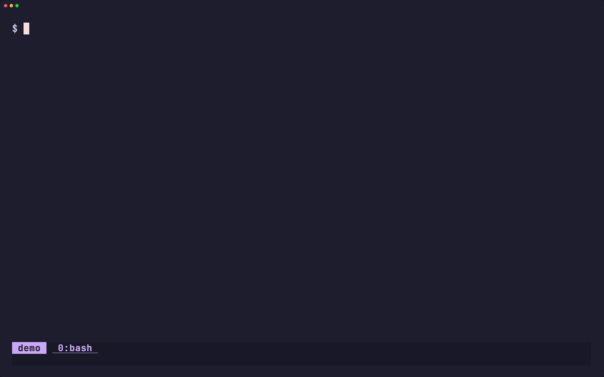
</p>

```console
$ template-revamped doctor | cat
tmux               ok       /opt/homebrew/bin/tmux, 3.8
gum                ok       /opt/homebrew/bin/gum, 2.0.2
notifier           ok       osascript
awk                ok       /usr/bin/awk, bsd 20200816
sed                ok       /usr/bin/sed, bsd
tr                 ok       /usr/bin/tr, bsd
date               ok       /bin/date, bsd
stat               ok       /usr/bin/stat, bsd
```

このリポジトリはtmuxにインストールして使うプラグインではありません。すべての`tmux-*-revamped`プラグインの出発点であり、それ自体もファミリーの一員なので、共有ファイルは他のすべてのメンバーと同一に保たれます。各メンバーが自分の名前で答えるコマンド`template-revamped`を同梱しています。サブコマンドは`doctor`、`version`、`help`で、メニューもあります。

---

## クイックスタート

### 前提条件

| ツール | バージョン | 用途 |
|:-----|:--------|:---------|
| tmux | 3.2以降 | ファミリーの全メンバーが対応する最低バージョン |
| POSIXシェル | 任意 | `sh`、`dash`、`bash` 3.2以降、`zsh` |
| gum | 任意 | メニュー、表、色。なくてもすべてのコマンドがプレーンテキストで動きます |
| gitとmake | 任意 | クローンとインストール |

### インストール

```bash
git clone https://github.com/tmux-revamped/tmux-plugin-template
cd tmux-plugin-template
make install
```

`make install`は`template-revamped`を`~/.local/bin`に、manページとbash、zsh、fishの補完を`~/.local/share`の下に置きます。別の場所に入れるときは`make install PREFIX=/usr/local`のように`PREFIX`を指定します。

### 確認

```bash
template-revamped doctor
```

`doctor`はツールごとに1行を表示し、パスと、コアツールについてはその種類とバージョンを示します。終了コードが1になるのは、必須のツールが見つからないときだけです。

## 使い方

| コマンド | 動作 |
|:--------|:-------------|
| `template-revamped` | 端末ではメニューを表示します。このマシンの確認か、ヘルプを選べます |
| `template-revamped doctor` | 依存するツールごとに1行。tmux、gum、デスクトップ通知、コアツール |
| `template-revamped version` | バージョンと、tmuxのバージョン |
| `template-revamped help` | ヘルプページ。`man template-revamped`も同じコマンド、オプション、設定を説明します |

| オプション | 意味 |
|:-------|:--------|
| `--theme NAME` | `kodougu`、`catppuccin-mocha`、`catppuccin-latte`、`dracula`、`nord`、`gruvbox`、`tokyo-night`、`mono`のいずれか。既定は`kodougu`です |

| 環境変数 | 意味 |
|:------------|:--------|
| `TEMPLATE_REVAMPED_THEME` | `--theme`がないときのテーマ |
| `TEMPLATE_REVAMPED_ACCENT` | テーマのアクセントを置き換える色。`#CBA6F7`など |
| `KODOUGU_THEME` | 上の2つがどちらもないときの、kodouguとtmux-revampedの全ツール共通のテーマ |
| `KODOUGU_ACCENT` | `TEMPLATE_REVAMPED_ACCENT`がないときの、kodouguとtmux-revampedの全ツール共通のアクセント |
| `NO_COLOR` | どのテーマでも色をなくします |

| tmuxオプション | 意味 |
|:------------|:--------|
| `@revamped_theme` | ほかに何も指定がないときの、tmux-revampedの全ツール共通のテーマ。既定は`kodougu`です |

テンプレートはキーを割り当てず、プレースホルダーも描画しません。

## 新しいプラグインの始め方

```bash
make new-member NAME=clipboard
```

これで`../tmux-clipboard-revamped`ができます。すべてのファイルをステージした新しいgitリポジトリです。

- `bin/clipboard-revamped`とそのmanページ、補完。名前と接頭辞はすべて置き換わります。`CLIPBOARD_REVAMPED_THEME`、`clipboard_revamped_help`、値が`0.0.0`の`CLIPBOARD_REVAMPED_VERSION`のようになります。
- 共有ライブラリ、テスト、CI、リリースのワークフロー、画面のスクリプト。[`FAMILY.md`](FAMILY.md)が同一と定めるファイルは1バイトも変わりません。
- ファミリー共通の見出しを持つエージェント向けガイドと、タイトルとファミリーの節だけのREADME。ガイドのGapsの節に残りの作業が並びます。README、プラグインのエントリーポイント、録画です。

`DEST`で別のディレクトリを指定できます。たとえば`make new-member NAME=clipboard DEST=/path/to/tmux-clipboard-revamped`です。そのあと次を行います。

1. ルートにエントリーポイント`clipboard-revamped.tmux`を追加します。TPMはプラグインのディレクトリにあるすべての`*.tmux`ファイルを実行します。プラグインの処理は`lib/clipboard.sh`に置きます。[tmux-time-revamped](https://github.com/tmux-revamped/tmux-time-revamped)はこの形で作られた完全なステータスプラグインです。
2. tmuxオプションはすべて`@clipboard_revamped_<name>`と名付け、ヘルプページ、manページ、補完、READMEに同じコミットで載せます。
3. 既定のキーは[`FAMILY.md`](FAMILY.md)のKey bindingsにある割り当てから多くても1つ選び、ほかの操作はすべて未割り当てにします。
4. `make screens`ですべての機能を録画し、テープが押すキーを字幕で示します。
5. 同じ作業の中で、全メンバーの[`FAMILY.md`](FAMILY.md)のメンバー表と`cmp`のループ、そして全READMEのファミリーの節にリポジトリを追加します。
6. 開発の節にあるチェックがすべて0で終わるまで実行します。

## 共有ライブラリ

ステータスプラグインはキャッシュを読み込み、そこから描画します。ステータスラインには保存済みの値がすぐに返り、古くなった値は切り離したサブシェルで計算し直されます。

```sh
#!/bin/sh

REVAMPED_LIB="$(cd "$(dirname "$0")/../lib" && pwd)"
REVAMPED_CACHE_PREFIX=clipboard_revamped
. "${REVAMPED_LIB}/cache.sh"

read_load() { uptime; }

revamped_cache_render load 5 read_load
```

| モジュール | プラグインが得るもの |
|:-------|:-----------------------|
| [`lib/cache.sh`](lib/cache.sh) | `revamped_cache_render`、`revamped_cache_get`、`revamped_cache_set`、`revamped_cache_age`、`revamped_cache_is_fresh`、`revamped_cache_refresh_if_stale`、`revamped_cache_set_if_stale`。値はすべてtmuxオプションに保持されます |
| [`lib/ticker.sh`](lib/ticker.sh) | サーバーごとに1つのバックグラウンド描画処理のための`revamped_ticker_start`、`revamped_ticker_run`、`revamped_ticker_interval` |
| [`lib/publish.sh`](lib/publish.sh) | まとめてオプションを書く`revamped_publish_add`と`revamped_publish_commit`、`#`をすべて二重にする`revamped_publish_escape`、固定幅のための`revamped_publish_pad`と`revamped_publish_width` |
| [`lib/tmux.sh`](lib/tmux.sh) | `revamped_tmux_get`、`revamped_tmux_set`、`revamped_tmux_unset`、ウィンドウとペインのオプションの補助関数、ペインとウィンドウの大きさ |
| [`lib/platform.sh`](lib/platform.sh) | `revamped_platform_os`、`revamped_platform_arch`、`revamped_is_macos`、`revamped_is_linux`、`revamped_is_bsd`、`revamped_is_apple_silicon`。どれもプロセスごとに1回だけ計算します |
| [`lib/notify.sh`](lib/notify.sh) | `revamped_notify_if_enabled`。プラグインのオプションが`1`のとき、`osascript`か`notify-send`でデスクトップ通知を出します |
| [`lib/command.sh`](lib/command.sh) | `revamped_has_command` |
| [`lib/log.sh`](lib/log.sh) | 任意で有効にするエラーログ`revamped_log_error` |
| [`lib/ui.sh`](lib/ui.sh)と[`lib/table.awk`](lib/table.awk) | 端末の画面。ヘッダー、入力、表、ログ、スピナー、ヘルプページを、gumが使えるところではgumで、それ以外ではプレーンテキストで描きます |
| [`lib/cli.sh`](lib/cli.sh) | メンバーのコマンドのためのテーマ選択、メニュー、使い方のエラー、ヘルプページ |
| [`lib/doctor.sh`](lib/doctor.sh) | `doctor`の各行。ツールごとのパス、種類、バージョン |
| [`lib/core.sh`](lib/core.sh) | バージョン定数 |

プロセス名、ネットワークの応答、ファイル名など、ユーザーの設定以外から来るテキストは、ステータスラインに届く前に`revamped_publish_escape`を通します。こうするとtmuxのフォーマットとして実行されることがありません。

ライブラリは、プラグインが選んだ接頭辞の下にある次のオプションを読みます。

| オプション | 読むモジュール | 意味 |
|:-------|:--------|:--------|
| `@<prefix>_<key>` | cache | キャッシュした値。経過時間は`_ts`、更新中は`_lock` |
| `@<prefix>_interval` | ticker | `minute`、またはバックグラウンド描画の間隔の秒数。それ以外は`status-interval`、次に5になります |
| `@<prefix>_ticker_pid` | ticker | バックグラウンド描画を担当するプロセス |
| `@<prefix>_fixed_width` | publish | `on`で値を本来の幅に詰めます |
| `@<prefix>_<metric>_width` | publish | 1つの値の幅を明示します |
| `@<namespace>_enable_logging` | エラーログ | `1`で`~/.tmux/<namespace>-logs/<namespace>.log`に書きます。1 MBを超えるとローテーションします |

`<prefix>`は、キャッシュでは`REVAMPED_CACHE_PREFIX`、tickerとpublishの関数では渡された引数です。`<namespace>`は`REVAMPED_LOG_NS`の`-`を`_`に変えたものです。

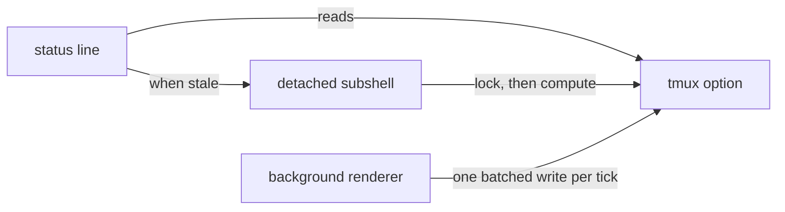

`revamped_cache_render`は保存済みのオプションの値を返します。値が指定された時間より古いと、ロック用のオプションを設定し、切り離したサブシェルで更新を始めるので、描画がコマンドを待つことはありません。20秒より古いロックは止まったものとみなすので、異常終了した更新が次の更新を妨げません。状態はすべてtmuxサーバーのオプションにあるため、ディスクには何も書かず、サーバーが止まると消えます。

プレースホルダーを頻繁に描画するプラグインのために、`revamped_ticker_run`はサーバーごとに1つのバックグラウンドプロセスを保ちます。`@<prefix>_ticker_pid`を確保し、1回の描画ごとに必要なオプションをすべて1回のtmux呼び出しで読み、描画し、すべての値と再描画をもう1回の呼び出しで書きます。別のプロセスがオプションを確保するか、サーバーが止まると終了します。

<a id="画面"></a>

## 画面

<details>
<summary><code>make screens</code>で本物のtmuxの中から録画したすべての画面。押したキーはステータスラインに表示されます</summary>
<br>

<table>
<tr>
<td width="50%" valign="top">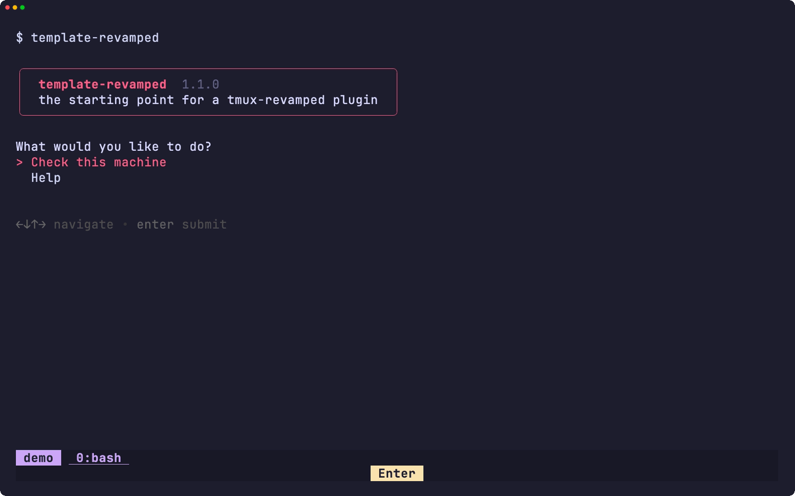<br><sub>メニュー。<code>hero.tape</code>より</sub></td>
<td width="50%" valign="top">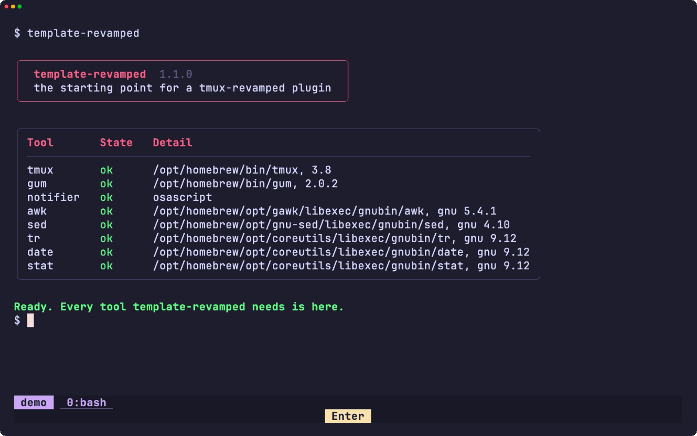<br><sub>doctorがすべてのツールを確認。<code>hero.tape</code>より</sub></td>
</tr>
<tr>
<td width="50%" valign="top">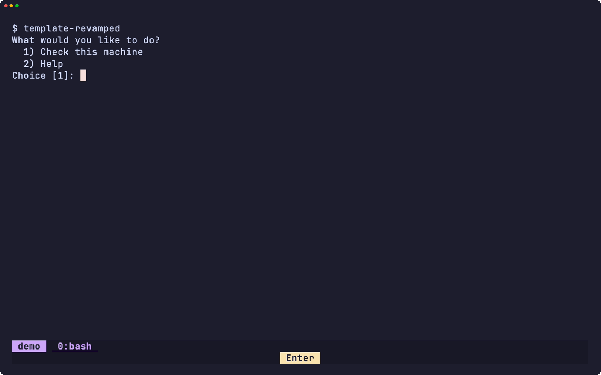<br><sub>gumなしのメニュー。<code>stills.tape</code>より</sub></td>
<td width="50%" valign="top">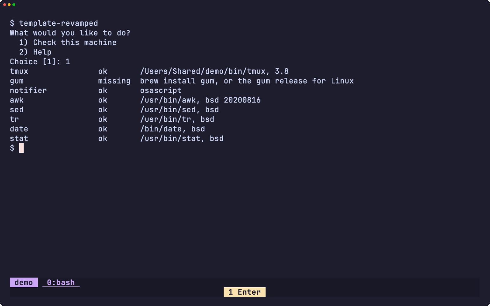<br><sub>gumなしのdoctor。macOS付属のツールで実行。<code>stills.tape</code>より</sub></td>
</tr>
<tr>
<td width="50%" valign="top">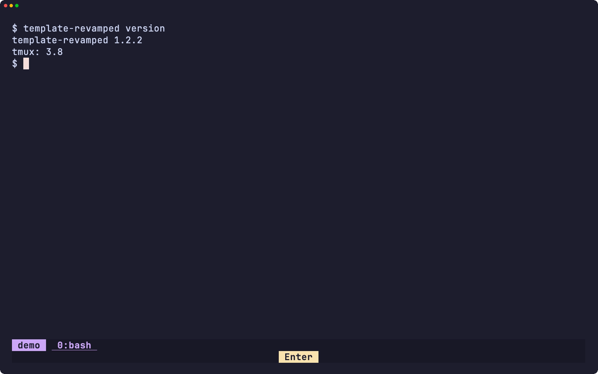<br><sub>バージョン。<code>stills.tape</code>より</sub></td>
<td width="50%" valign="top">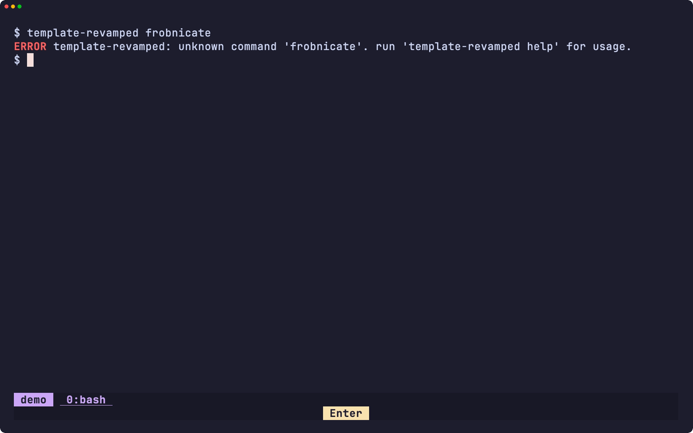<br><sub>不明なコマンド。<code>stills.tape</code>より</sub></td>
</tr>
<tr>
<td width="50%" valign="top">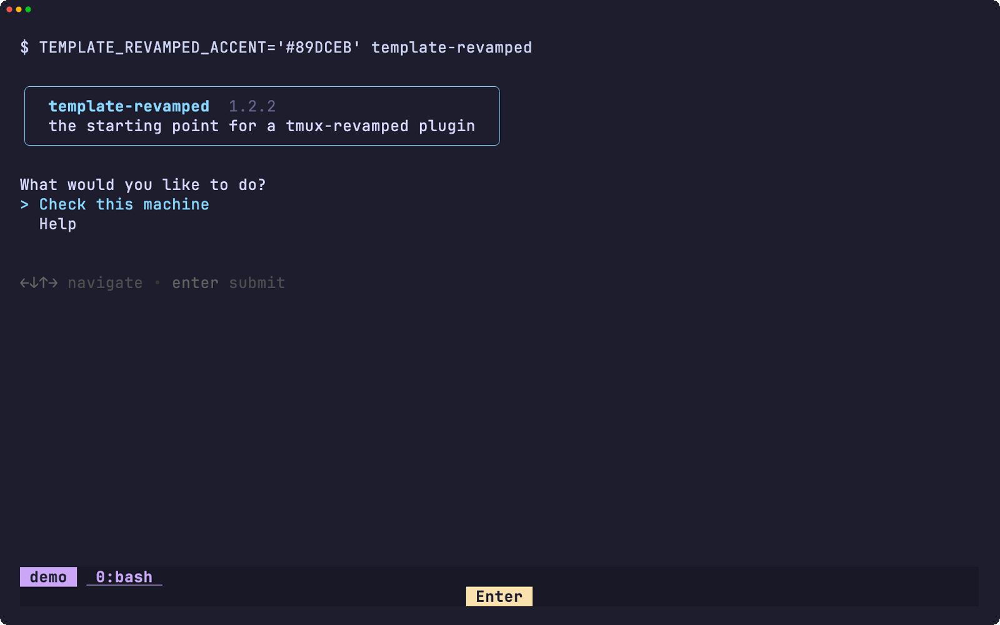<br><sub><code>TEMPLATE_REVAMPED_ACCENT</code>によるアクセント。<code>stills.tape</code>より</sub></td>
<td width="50%" valign="top">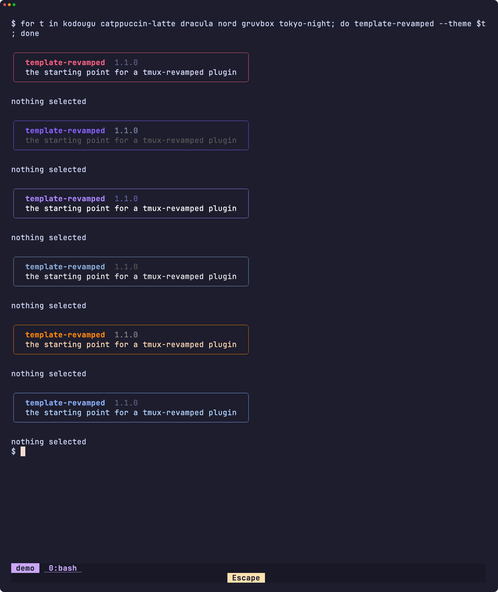<br><sub>6つのテーマのヘッダー。<code>themes.tape</code>より</sub></td>
</tr>
<tr>
<td width="50%" valign="top">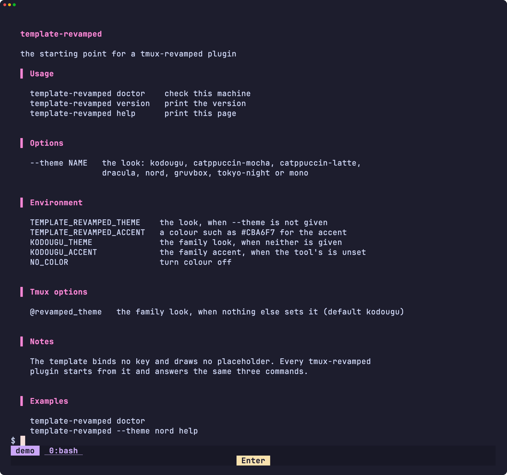<br><sub>ヘルプページ。<code>help.tape</code>より</sub></td>
<td width="50%" valign="top"></td>
</tr>
</table>

</details>

## 移植性

ライブラリとツールはPOSIX `sh`です。CIは下の各行ですべてのテストを実行します。

| シェル | 状態 |
|:------|:-------|
| `dash`、macOSの`/bin/sh` | 対応 |
| `bash` 3.2と5.x、システムの`zsh`とHomebrewの`zsh` | 対応 |

| システム | 状態 |
|:-------|:-------|
| macOS | Apple SiliconとIntelのTahoe。付属のツール、HomebrewのGNUツール、Homebrewのuutilsで確認 |
| Linux | x86_64とarm64のUbuntu 26.04。GNU coreutils、uutils、BusyBoxで確認 |
| FreeBSD、OpenBSD、NetBSD | CIの対象外 |

`template-revamped doctor`は`gnu 9.12`、`uutils 0.12.0`、`bsd 20200816`のように、各コアツールの種類とバージョンを示します。そのため不具合の報告から、どのツールで動いたかがわかります。

## 開発

| コマンド | 実行内容 |
|:--------|:-------------|
| `make fmt` | すべてのスクリプトにshfmt `-i 2`をかけます |
| `make lint` | shfmt、ShellCheck、mandoc、yamllint、actionlintを、指摘ゼロで通します |
| `make test` | システムの`sh`でbatsのテスト |
| `make test-all` | インストール済みのすべてのシェルでテスト。macOSではbashとzshの両方のビルドを含みます |
| `make test-linux` | Ubuntuのコンテナでテスト |
| `make coverage` | このMacとUbuntuのコンテナでbashcovを実行し、合算して100パーセントで判定します |
| `make screens` | 上の画面を、本物のツールからtmuxの中でVHSで録画します。macOSで実行します |
| `make install` | ツール、manページ、補完を`PREFIX`の下に置きます |
| `make new-member NAME=<name>` | 新しいメンバー。新しいプラグインの始め方の節を参照 |

macOS では、`brew bundle` を実行すると、これらのターゲットが使うツールがすべて [`Brewfile`](Brewfile) からインストールされます。

[`test/docs.bats`](test/docs.bats)は、このREADMEの相対リンクが存在しないパスを指すと失敗します。

コミットはConventional Commitsの形式に従い、そのまま`main`に入ります。`main`で`ci`が成功すると、`release.yml`がsemantic-releaseを実行します。前回のタグ以降に`feat`か`fix`があればリリースを公開し、バージョン定数を更新し、変更内容を[`CHANGELOG.md`](CHANGELOG.md)に追加します。

## ライセンス

[MIT](LICENSE)、copyright Gustavo Franco。

<!-- family:begin -->

## tmux-revamped ファミリー

このプラグインは tmux-revamped ファミリーの一員です。すべてのメンバーが [`FAMILY.md`](FAMILY.md) の同じ規約と同じ共有ライブラリを持ちます。メンバーは一緒にインストールする前提で作られており、ほかのメンバーが使うキーや tmux オプションを使うメンバーはありません。

あるメンバーで見つかった不具合は、修正完了とする前に全メンバーで同じ不具合を探します。

| メンバー | 機能 |
|---|---|
| [`tmux-autoreload-revamped`](https://github.com/tmux-revamped/tmux-autoreload-revamped) | tmuxの設定を編集して保存するだけで、キーもコマンドも使わずに自動で再読み込みされます |
| [`tmux-battery-revamped`](https://github.com/tmux-revamped/tmux-battery-revamped) | tmuxのステータスバーに電池の状態を表示し、ステータスの描画を一切止めません |
| [`tmux-bluetooth-revamped`](https://github.com/tmux-revamped/tmux-bluetooth-revamped) | 接続中のすべてのBluetooth機器とその電池残量をtmuxのステータスバーに表示し、描画を止めません |
| [`tmux-cpu-revamped`](https://github.com/tmux-revamped/tmux-cpu-revamped) | CPUの負荷、温度、周波数をtmuxのステータスバーに表示し、描画を一切止めません |
| [`tmux-disk-revamped`](https://github.com/tmux-revamped/tmux-disk-revamped) | tmuxのステータスバーにディスク使用量を表示し、ステータスの描画を一切止めません |
| [`tmux-extract-revamped`](https://github.com/tmux-revamped/tmux-extract-revamped) | 画面上の URL、パス、ハッシュなどのトークンを fzf で選び、カーソル位置に入力します。純粋なシェルだけで動きます |
| [`tmux-fzf-revamped`](https://github.com/tmux-revamped/tmux-fzf-revamped) | ポップアップ内の fzf ピッカーから、tmux のセッション、ウィンドウ、ペインの切り替え、終了、名前変更、作成を行います |
| [`tmux-git-revamped`](https://github.com/tmux-revamped/tmux-git-revamped) | アクティブなペインのgitブランチ、変更、プロバイダーの件数を、描画を止めずにtmuxのステータスバーに表示します |
| [`tmux-gpu-revamped`](https://github.com/tmux-revamped/tmux-gpu-revamped) | NVIDIA、AMD、Intel、Apple の GPU の負荷、温度、クロック、電力、メモリを tmux のステータスバーに表示します |
| [`tmux-kube-revamped`](https://github.com/tmux-revamped/tmux-kube-revamped) | 現在の Kubernetes コンテキストと名前空間を、kubectl を使わずに kubeconfig から解析して tmux のステータスバーに表示します |
| [`tmux-launcher-revamped`](https://github.com/tmux-revamped/tmux-launcher-revamped) | 任意の TUI アプリを、現在のペインのディレクトリでポップアップまたはウィンドウとして起動します。アプリごとにキーを設定できます |
| [`tmux-logging-revamped`](https://github.com/tmux-revamped/tmux-logging-revamped) | 任意のペインをファイルに保存します。ライブのログ記録、スクロールバック全体、1 回限りのスクリーンショットに対応します |
| [`tmux-music-revamped`](https://github.com/tmux-revamped/tmux-music-revamped) | 再生中の曲をステータスバーに表示し、ステータスの描画を止めません |
| [`tmux-network-revamped`](https://github.com/tmux-revamped/tmux-network-revamped) | ネットワークのスループットをステータスバーに表示し、描画を止めません |
| [`tmux-pain-control-revamped`](https://github.com/tmux-revamped/tmux-pain-control-revamped) | tmux のペインとウィンドウの操作キー。tmux のバージョンに対応し、vim と共存でき、どの prefix キーも無効にできます |
| [`tmux-persist-revamped`](https://github.com/tmux-revamped/tmux-persist-revamped) | tmuxのすべてのセッション、ウィンドウ、ペインを保存し、タイマーで自動保存して、再起動後にすべて復元します |
| [`tmux-plugin-template`](https://github.com/tmux-revamped/tmux-plugin-template) | **このプラグイン**、tmux-revampedプラグインの出発点です。共有ライブラリ、batsハーネス、CIを含みます |
| [`tmux-pomodoro-revamped`](https://github.com/tmux-revamped/tmux-pomodoro-revamped) | すべての状態をtmuxオプションに保持し、一時ファイルを使わない、tmuxステータスバーのポモドーロタイマーです |
| [`tmux-ram-revamped`](https://github.com/tmux-revamped/tmux-ram-revamped) | RAM、スワップ、メモリプレッシャーをtmuxのステータスバーに表示します。計測はバックグラウンドで行うため描画を待たせません |
| [`tmux-reorder-revamped`](https://github.com/tmux-revamped/tmux-reorder-revamped) | tmuxのステータスバー上でウィンドウのタブをマウスでドラッグして、そのウィンドウを移動します |
| [`tmux-scroll-revamped`](https://github.com/tmux-revamped/tmux-scroll-revamped) | 自分でスクロールできるアプリにはマウスホイールを渡し、それ以外ではtmuxのコピーモードに入ります |
| [`tmux-sensible-revamped`](https://github.com/tmux-revamped/tmux-sensible-revamped) | tmuxのバージョンと端末に合わせて適用され、ユーザーが設定したオプションには触れない、妥当な初期設定です |
| [`tmux-tiling-revamped`](https://github.com/tmux-revamped/tmux-tiling-revamped) | tmuxのタイル型ウィンドウ管理です。BSPのdwindleとspiralを含む8つのレイアウトと、レイアウトの取り消しがあります |
| [`tmux-time-revamped`](https://github.com/tmux-revamped/tmux-time-revamped) | ステータスバーにローカル時計と世界時計を時間帯ごとの色で表示し、カウントダウンと夏時間の警告も出します |
| [`tmux-weather-revamped`](https://github.com/tmux-revamped/tmux-weather-revamped) | wttr.inの天気をバックグラウンドで取得し、ステータスバーを待たせずに表示します |

<!-- family:end -->
