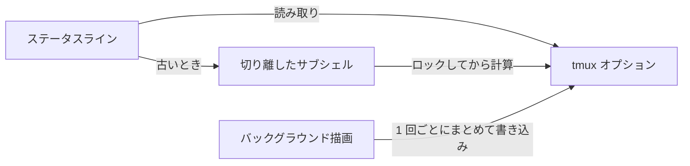

<div align="center">

# tmux-plugin-template

<strong>tmux-revampedプラグインの出発点です。共有ライブラリ、batsハーネス、CI、ファミリーのツールを含みます。</strong>

[English](README.md) &nbsp;|&nbsp; 日本語 &nbsp;|&nbsp; [简体中文](README.zh-Hans.md) &nbsp;|&nbsp; [繁體中文（香港）](README.zh-HK.md)

[](https://github.com/tmux-revamped/tmux-plugin-template/actions/workflows/tests.yml)
[](LICENSE)
[](CHANGELOG.md)

<p align="center">
  <a href="#機能">機能</a> &nbsp;|&nbsp;
  <a href="#動作要件">動作要件</a> &nbsp;|&nbsp;
  <a href="#新しいプラグインの始め方">新しいプラグインの始め方</a> &nbsp;|&nbsp;
  <a href="#使い方">使い方</a> &nbsp;|&nbsp;
  <a href="#設定">設定</a> &nbsp;|&nbsp;
  <a href="#仕組み">仕組み</a>
</p>

</div>

共有ライブラリのモジュールが**8**個。ファミリーのコマンドが**10**個。UbuntuとmacOS、x86_64とarm64にまたがるCIのテストジョブが**10**個です。

---

## 機能

このリポジトリはインストールして使うプラグインではありません。すべての`tmux-*-revamped`プラグインの出発点であり、それ自体もファミリーの一員なので、共有ファイルは他のすべてのメンバーと同一に保たれます。

| 部分 | パス | 新しいプラグインが得るもの |
|:-----|:-----|:-----------------------|
| 共有ライブラリ | [`src/lib`](src/lib) | tmuxオプションに保持するステータスのキャッシュ、バックグラウンドの描画処理、まとめて行うオプションの書き込み、tmuxオプションの補助関数、プラットフォームの判定、任意で有効にするエラーログ |
| テストハーネス | [`test`](test) | 単体テスト用のメモリー上のtmuxモックと、結合テスト用の専用ソケットのtmuxサーバーを備えたbatsの補助関数 |
| CI | [`.github/workflows`](.github/workflows) | GNU、BSD、uutilsのツールを使ったUbuntuとmacOSでのテスト、shellcheck、actionlint、下限95パーセントのkcov、バージョンの確認、新しいバージョンごとのリリース、毎週のファミリーの確認 |
| ファミリーのツール | [`family/bin`](family/bin) | [`FAMILY.md`](FAMILY.md)にあるファミリーの規約のための、監査、同期、伝播、一斉調査、診断、README生成 |
| makeのターゲット | [`Makefile`](Makefile) | `test`、`test-unit`、`coverage`、`lint`、`clean` |

## 動作要件

| ツール | バージョン | 用途 |
|:-----|:--------|:---------|
| tmux | 3.2以降 | すべてのメンバーが対応するファミリーの下限 |
| bash | 3.2以降 | ライブラリとテストはmacOSの`/bin/bash`で動きます |
| bats-core | 任意のバージョン | `make test` |
| shellcheck | 任意のバージョン | `make lint` |
| kcovとpython3 | 任意のバージョン | `make coverage`、Linuxのみ |

## 新しいプラグインの始め方

1. 新しい名前でテンプレートをコピーし、新しいリポジトリを指すようにします。

   ```bash
   git clone https://github.com/tmux-revamped/tmux-plugin-template tmux-example-revamped
   cd tmux-example-revamped
   git remote set-url origin https://github.com/tmux-revamped/tmux-example-revamped.git
   ```

2. ルートにエントリーポイント`example-revamped.tmux`を追加します。TPMはプラグインのディレクトリにあるすべての`*.tmux`ファイルを実行します。プラグインの処理は`src/example.sh`に、独自のモジュールは`src/lib/example/`に置きます。[tmux-time-revamped](https://github.com/tmux-revamped/tmux-time-revamped)はこの方法で作った完成したステータスプラグインです。
3. [`src/lib/utils/constants.sh`](src/lib/utils/constants.sh)の`TMUX_PLUGIN_TEMPLATE_VERSION`を`EXAMPLE_REVAMPED_VERSION`に改名します。CIの`version`ジョブは、この定数、[`CHANGELOG.md`](CHANGELOG.md)の最初のバージョン付き見出し、READMEの`version-X.Y.Z`バッジが一致しないと失敗します。
4. tmuxオプションはすべて`@example_revamped_<name>`と名付けます。CIのlintジョブはディレクトリ名からスラッグを取り、[`src/`](src)配下のオプションが[`README.md`](README.md)にないと失敗します。
5. 既定のキーは、[`family/KEYS.md`](family/KEYS.md)の割り当てから多くても1つを選び、他の動作は既定で割り当てないままにします。
6. [`family/MEMBERS`](family/MEMBERS)にリポジトリを追加します。どちらのファイルも共有されているので、1つのメンバーで変更してから`family/bin/propagate --message 'chore(family): add tmux-example-revamped'`を実行します。これがすべてのメンバーにファイルをコピーし、プルリクエストを作ります。
7. このREADMEと同じヘッダーでREADMEを書き、`family:begin`と`family:end`の目印を残します。[`family/bin/gen-readme`](family/bin/gen-readme)が、[`family/MEMBERS`](family/MEMBERS)のメンバー一覧と各メンバーの説明文から、その間の節を埋めます。
8. 開発の節にある検査を、すべて0で終了するまで実行します。

[`family/OWNERSHIP`](family/OWNERSHIP)で`owned`とされたファイルは、すべてのメンバーでバイト単位で同一に保たれます。それらは[`family/bin/propagate`](family/bin/propagate)を通してのみ変更してください。

## 使い方

ステータスプラグインはキャッシュを読み込み、そこから描画します。ステータスラインは保存済みの値をすぐに受け取り、古い値は切り離したサブシェルで計算し直します。

```bash
#!/usr/bin/env bash

PLUGIN_DIR="$(cd "$(dirname "${BASH_SOURCE[0]}")/.." && pwd)"
export CACHE_PREFIX="example_revamped"
source "${PLUGIN_DIR}/src/lib/utils/cache.sh"

read_load() { uptime; }

cache_render load 5 read_load
```

| モジュール | 関数 |
|:-------|:----------|
| [`src/lib/utils/cache.sh`](src/lib/utils/cache.sh) | `cache_render`、`cache_get`、`cache_set`、`cache_age`、`cache_is_fresh`、`cache_refresh_if_stale`、`cache_set_if_stale` |
| [`src/lib/utils/ticker.sh`](src/lib/utils/ticker.sh) | サーバーごとに1つのバックグラウンド描画処理のための`ticker_start`、`ticker_run`、`ticker_interval` |
| [`src/lib/utils/publish.sh`](src/lib/utils/publish.sh) | まとめて書き込むための`publish_add`、`publish_commit`、すべての`#`を二重にする`publish_escape`、固定幅のための`publish_pad`と`publish_width` |
| [`src/lib/tmux/tmux-ops.sh`](src/lib/tmux/tmux-ops.sh) | `get_tmux_option`、`set_tmux_option`、`unset_tmux_option`、ウィンドウとペインのオプションの補助関数、ペインとウィンドウの大きさの取得 |
| [`src/lib/utils/platform.sh`](src/lib/utils/platform.sh) | `platform_os`、`platform_arch`、`is_macos`、`is_linux`、`is_bsd`、`is_apple_silicon`。いずれもプロセスごとに1回だけ計算します |
| [`src/lib/utils/has-command.sh`](src/lib/utils/has-command.sh) | `has_command` |
| [`src/lib/utils/error-logger.sh`](src/lib/utils/error-logger.sh) | `log_error` |
| [`src/lib/utils/constants.sh`](src/lib/utils/constants.sh) | バージョンの定数と共通の既定値 |

プロセス名、ネットワークの応答、ファイル名など、ユーザーの設定以外から来る文字列は、ステータスラインに届く前に`publish_escape`を通します。これでtmuxのフォーマットとして実行されることはありません。

## 設定

テンプレートはキーを割り当てず、独自のオプションも読みません。ライブラリは、プラグインが選んだ接頭辞のもとで次のオプションを読みます。

| オプション | 読むもの | 意味 |
|:-------|:--------|:--------|
| `@<prefix>_<key>` | キャッシュ | キャッシュした値。経過時間を表す`_ts`と、更新中を表す`_lock`が付随します |
| `@<prefix>_interval` | ticker | `minute`か、バックグラウンド描画の間隔の秒数。それ以外は`status-interval`、さらに5の順で代わりに使います |
| `@<prefix>_ticker_pid` | ticker | バックグラウンド描画を担当するプロセス |
| `@<prefix>_fixed_width` | publish | `on`で値を本来の幅まで詰める |
| `@<prefix>_<metric>_width` | publish | 1つの値の幅を直接指定 |
| `@<namespace>_enable_logging` | エラーログ | `1`で`~/.tmux/<namespace>-logs/<namespace>.log`に書き込み、1 MBを超えるとローテーション |

`<prefix>`は、キャッシュでは`CACHE_PREFIX`、tickerとpublishの関数では渡した引数です。`<namespace>`は`PLUGIN_LOG_NS`の`-`を`_`に置き換えたものです。

## 仕組み



`cache_render`は保存済みのオプションの値を返します。値が指定した経過時間より古ければ、ロックのオプションを設定し、切り離したサブシェルで更新を始めるので、描画がコマンドを待つことはありません。20秒より古いロックは無効とみなすので、異常終了した更新が次の更新を妨げることはありません。状態はすべてtmuxサーバーのオプションにあるので、ディスクには何も書かず、サーバーが止まれば消えます。

プレースホルダーが頻繁に実行されるプラグインでは、`ticker_run`がサーバーごとに1つのバックグラウンドプロセスを保ちます。このプロセスは`@<prefix>_ticker_pid`を取得し、1回ごとに必要なオプションを1回のtmux呼び出しですべて読み、描画し、すべての値と再描画をもう1回の呼び出しで書き込み、別のプロセスがこのオプションを取得するかサーバーが止まると終了します。

## 開発

| コマンド | 実行するもの |
|:--------|:-------------|
| `make test` | batsのテストスイート |
| `make test-unit` | [`test/lib`](test/lib)配下の単体テスト |
| `make lint` | すべてのシェルファイルとファミリーのすべてのコマンドに対するwarningレベルのshellcheck |
| `make coverage` | 下限95パーセントのkcovによる行カバレッジ、Linuxのみ |
| [`family/bin/audit`](family/bin/audit) | ファミリーの規約に対するこのリポジトリの検査 |

[`test/docs.bats`](test/docs.bats)は、このREADMEの相対リンクが存在しないパスを指していると失敗します。

## ライセンス

[MIT](LICENSE)、copyright Gustavo Franco。

<!-- family:begin -->

## tmux-revampedファミリー

このプラグインはtmux-revampedファミリーの一員です。すべてのメンバーが[`FAMILY.md`](FAMILY.md)の同じ規約、`family/`配下の同じツール、同じ共有ライブラリを持ち、チェックサムの一覧によってバイト単位で同一に保たれています。メンバーはまとめてインストールする前提で作られており、他のメンバーが使うキーやtmuxオプションを別のメンバーが使うことはありません。

あるメンバーで見つかった不具合は、修正完了とする前に全メンバーで調べます。この義務は記憶に頼らず規約に書かれており、`family/bin/sweep`がそれを果たす手段です。

| メンバー | 機能 |
|---|---|
| [`tmux-autoreload-revamped`](https://github.com/tmux-revamped/tmux-autoreload-revamped) | tmuxの設定を編集して保存すると、キーもコマンドもなしに自動で再読み込みします |
| [`tmux-battery-revamped`](https://github.com/tmux-revamped/tmux-battery-revamped) | ステータスバーの描画を止めずに、バッテリーの状態を表示します |
| [`tmux-bluetooth-revamped`](https://github.com/tmux-revamped/tmux-bluetooth-revamped) | 接続中のBluetooth機器とそのバッテリーを、描画を止めずにステータスバーに表示します |
| [`tmux-cpu-revamped`](https://github.com/tmux-revamped/tmux-cpu-revamped) | CPUの負荷、温度、周波数を、描画を止めずにステータスバーに表示します |
| [`tmux-disk-revamped`](https://github.com/tmux-revamped/tmux-disk-revamped) | ステータスバーの描画を止めずに、ディスク使用量を表示します |
| [`tmux-extract-revamped`](https://github.com/tmux-revamped/tmux-extract-revamped) | 画面上のURL、パス、ハッシュなどをfzfで選び、カーソル位置に入力します。シェルだけで動きます |
| [`tmux-fzf-revamped`](https://github.com/tmux-revamped/tmux-fzf-revamped) | ポップアップのfzfでtmuxのセッション、ウィンドウ、ペインを切り替え、終了、名前変更、作成します |
| [`tmux-git-revamped`](https://github.com/tmux-revamped/tmux-git-revamped) | アクティブなペインのgitブランチ、変更、プロバイダーの件数を、止めずにステータスバーに表示します |
| [`tmux-gpu-revamped`](https://github.com/tmux-revamped/tmux-gpu-revamped) | NVIDIA、AMD、Intel、AppleのGPUの負荷、温度、クロック、電力、メモリーをステータスバーに表示します |
| [`tmux-kube-revamped`](https://github.com/tmux-revamped/tmux-kube-revamped) | kubectlを使わずkubeconfigから読んだKubernetesのコンテキストと名前空間をステータスバーに表示します |
| [`tmux-launcher-revamped`](https://github.com/tmux-revamped/tmux-launcher-revamped) | 任意のTUIアプリを、現在のペインのディレクトリでポップアップかウィンドウとして起動します |
| [`tmux-logging-revamped`](https://github.com/tmux-revamped/tmux-logging-revamped) | ペインの内容をファイルに保存します。ライブ記録、スクロールバック全体、単発のスクリーンショットに対応します |
| [`tmux-music-revamped`](https://github.com/tmux-revamped/tmux-music-revamped) | ステータスバーの描画を止めずに、再生中の曲を表示します |
| [`tmux-network-revamped`](https://github.com/tmux-revamped/tmux-network-revamped) | 描画を止めずに、ネットワークのスループットをステータスバーに表示します |
| [`tmux-pain-control-revamped`](https://github.com/tmux-revamped/tmux-pain-control-revamped) | tmuxのペインとウィンドウを操作する標準的なキーバインドです。バージョンを判別し、vimと共存し、すべて設定できます |
| [`tmux-persist-revamped`](https://github.com/tmux-revamped/tmux-persist-revamped) | tmuxのセッション、ウィンドウ、ペインをすべて保存し、タイマーで自動保存し、再起動後に復元します |
| [`tmux-plugin-template`](https://github.com/tmux-revamped/tmux-plugin-template) | **このプラグイン**、tmux-revampedプラグインの出発点です。共有ライブラリ、batsハーネス、CI、ファミリーのツールを含みます |
| [`tmux-pomodoro-revamped`](https://github.com/tmux-revamped/tmux-pomodoro-revamped) | 状態をすべてtmuxオプションに保持し、一時ファイルを使わないステータスバーのポモドーロタイマーです |
| [`tmux-ram-revamped`](https://github.com/tmux-revamped/tmux-ram-revamped) | RAM、スワップ、メモリー圧迫をバックグラウンドで測り、待たずにステータスバーに表示します |
| [`tmux-reorder-revamped`](https://github.com/tmux-revamped/tmux-reorder-revamped) | ステータスバーのウィンドウタブをマウスでドラッグして、そのウィンドウを移動します |
| [`tmux-scroll-revamped`](https://github.com/tmux-revamped/tmux-scroll-revamped) | 自分でスクロールするアプリにはマウスホイールを渡し、それ以外ではtmuxのコピーモードに入ります |
| [`tmux-sensible-revamped`](https://github.com/tmux-revamped/tmux-sensible-revamped) | tmuxのバージョンと端末に合わせた妥当な初期設定です。ユーザーが設定したオプションには触れません |
| [`tmux-tiling-revamped`](https://github.com/tmux-revamped/tmux-tiling-revamped) | tmuxのタイル型ウィンドウ管理です。BSPのdwindleとspiralを含む8つのレイアウトと、レイアウトの取り消しがあります |
| [`tmux-time-revamped`](https://github.com/tmux-revamped/tmux-time-revamped) | ローカル時計と世界時計を時間帯ごとの色で表示し、カウントダウンと夏時間の警告も出します |
| [`tmux-weather-revamped`](https://github.com/tmux-revamped/tmux-weather-revamped) | wttr.inの天気をバックグラウンドで取得し、ステータスバーを待たせずに表示します |

### インストールの確認

すべてのメンバーがディスク上にあれば、1つのコマンドでメンバー間の衝突を報告できます。

```sh
family/bin/doctor --live
```

各メンバーと実行中のtmuxサーバーを読み取り、重複したキー、重複したステータスのプレースホルダー、命名規則に合わないオプション、規約のバージョンが遅れているメンバーを報告します。

<!-- family:end -->
