<div align="center">

# tmux-plugin-template

<strong>The starting point for a tmux-revamped plugin: shared library, bats harness and CI.</strong>

English &nbsp;|&nbsp; [日本語](README.ja.md) &nbsp;|&nbsp; [简体中文](README.zh-Hans.md) &nbsp;|&nbsp; [繁體中文（香港）](README.zh-HK.md)

[](https://github.com/tmux-revamped/tmux-plugin-template/actions/workflows/ci.yml)
[](https://github.com/tmux-revamped/tmux-plugin-template/releases/latest)
[](https://scorecard.dev/viewer/?uri=github.com/tmux-revamped/tmux-plugin-template)
[](LICENSE)

<p align="center">
  <a href="#quick-start"><strong>Quick start</strong></a> &nbsp;|&nbsp;
  <a href="#usage">Usage</a> &nbsp;|&nbsp;
  <a href="#starting-a-new-plugin">Starting a new plugin</a> &nbsp;|&nbsp;
  <a href="#the-shared-library">The shared library</a> &nbsp;|&nbsp;
  <a href="#screens">Screens</a>
</p>

</div>

<p align="center">
  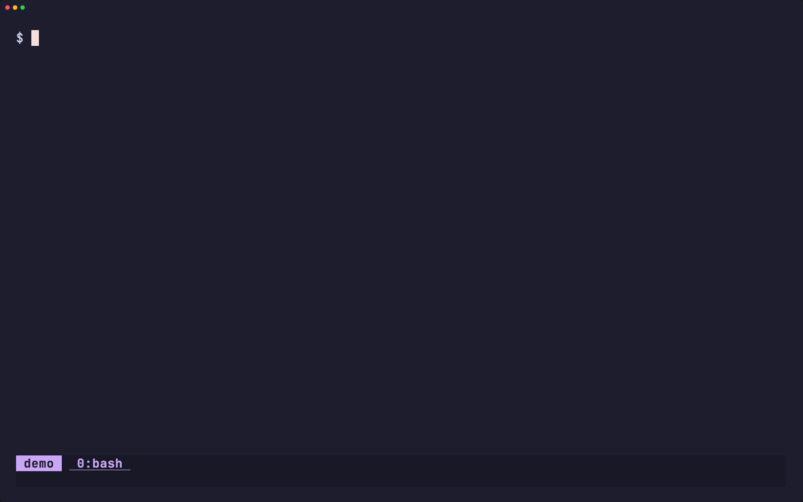
</p>

```console
$ template-revamped doctor | cat
tmux               ok       /opt/homebrew/bin/tmux, 3.8
gum                ok       /opt/homebrew/bin/gum, 2.0.2
notifier           ok       osascript
awk                ok       /usr/bin/awk, bsd 20200816
sed                ok       /usr/bin/sed, bsd
tr                 ok       /usr/bin/tr, bsd
date               ok       /bin/date, bsd
stat               ok       /usr/bin/stat, bsd
```

This repository is not a plugin you install into tmux. It is the base every `tmux-*-revamped` plugin starts from, and a member of the family itself, so its shared files stay identical to every other member's. It ships `template-revamped`, the command every member answers with its own name: `doctor`, `version`, `help` and a menu.

---

## Quick start

### Prerequisites

| Tool | Version | Used for |
|:-----|:--------|:---------|
| tmux | 3.2 or later | the family floor every member supports |
| A POSIX shell | any | `sh`, `dash`, `bash` 3.2 and later, and `zsh` |
| gum | optional | the menu, tables and colours; without it every command prints plain text |
| git and make | any | cloning and installing |

### Install

```bash
git clone https://github.com/tmux-revamped/tmux-plugin-template
cd tmux-plugin-template
make install
```

`make install` puts `template-revamped` in `~/.local/bin`, its man page and its bash, zsh and fish completions under `~/.local/share`. Set `PREFIX` to install elsewhere, as in `make install PREFIX=/usr/local`.

### Verify

```bash
template-revamped doctor
```

`doctor` prints one row per tool, with its path and, for a core tool, its flavor and version. It exits 1 only when a required tool is missing.

## Usage

| Command | What it does |
|:--------|:-------------|
| `template-revamped` | On a terminal, a menu: check this machine, or read the help |
| `template-revamped doctor` | One row per dependency: tmux, gum, the desktop notifier and the core tools |
| `template-revamped version` | The version, then the tmux version |
| `template-revamped help` | The help page. `man template-revamped` documents the same commands, options and settings |

| Option | Meaning |
|:-------|:--------|
| `--theme NAME` | `kodougu`, `catppuccin-mocha`, `catppuccin-latte`, `dracula`, `nord`, `gruvbox`, `tokyo-night` or `mono`. The default is `kodougu` |

| Environment | Meaning |
|:------------|:--------|
| `TEMPLATE_REVAMPED_THEME` | The theme when `--theme` is not given |
| `TEMPLATE_REVAMPED_ACCENT` | A colour such as `#CBA6F7` that replaces the theme's accent |
| `KODOUGU_THEME` | The theme of every kodougu and tmux-revamped tool, when neither of the above is set |
| `KODOUGU_ACCENT` | The accent of every kodougu and tmux-revamped tool, when `TEMPLATE_REVAMPED_ACCENT` is not set |
| `NO_COLOR` | Turns colour off in every theme |

| tmux option | Meaning |
|:------------|:--------|
| `@revamped_theme` | The theme of every tmux-revamped tool, when nothing else sets one. The default is `kodougu` |

The template binds no key and draws no placeholder.

## Starting a new plugin

```bash
make new-member NAME=clipboard
```

This creates `../tmux-clipboard-revamped`, a new git repository with every file staged:

- `bin/clipboard-revamped`, its man page and completions, with every name and prefix renamed: `CLIPBOARD_REVAMPED_THEME`, `clipboard_revamped_help`, `CLIPBOARD_REVAMPED_VERSION` at `0.0.0`.
- The shared library, the suites, CI, the release workflow and the screens scripts, byte for byte where [`FAMILY.md`](FAMILY.md) lists a file as identical.
- An agent guide with the family's headings, and a README holding its title and the family section. Its Gaps section lists what is left: the README, the plugin's entry point and its recordings.

`DEST` picks another directory, as in `make new-member NAME=clipboard DEST=/path/to/tmux-clipboard-revamped`. Then:

1. Add the entry point `clipboard-revamped.tmux` at the root; TPM runs every `*.tmux` file in a plugin directory. Put the plugin's logic in `lib/clipboard.sh`. [tmux-time-revamped](https://github.com/tmux-revamped/tmux-time-revamped) is a complete status plugin built this way.
2. Name every tmux option `@clipboard_revamped_<name>`, and list each one in the help page, the man page, the completions and the README in the same commit.
3. Pick at most one default key from the allocation under Key bindings in [`FAMILY.md`](FAMILY.md), and leave every other action unbound.
4. Record every feature with `make screens`, captioning each key the tape presses.
5. Add the repository to the member table and the `cmp` loop in [`FAMILY.md`](FAMILY.md), and to the family section of every README, in every member in the same task.
6. Run the gates under Development until all of them exit 0.

## The shared library

A status plugin sources the cache and renders from it. The status line gets the stored value at once, and a stale value is recomputed in a detached subshell:

```sh
#!/bin/sh

REVAMPED_LIB="$(cd "$(dirname "$0")/../lib" && pwd)"
REVAMPED_CACHE_PREFIX=clipboard_revamped
. "${REVAMPED_LIB}/cache.sh"

read_load() { uptime; }

revamped_cache_render load 5 read_load
```

| Module | What it gives a plugin |
|:-------|:-----------------------|
| [`lib/cache.sh`](lib/cache.sh) | `revamped_cache_render`, `revamped_cache_get`, `revamped_cache_set`, `revamped_cache_age`, `revamped_cache_is_fresh`, `revamped_cache_refresh_if_stale` and `revamped_cache_set_if_stale`, with every value kept in tmux options |
| [`lib/ticker.sh`](lib/ticker.sh) | `revamped_ticker_start`, `revamped_ticker_run` and `revamped_ticker_interval`, for one background renderer per server |
| [`lib/publish.sh`](lib/publish.sh) | `revamped_publish_add` and `revamped_publish_commit` for batched option writes, `revamped_publish_escape` to double every `#`, and `revamped_publish_pad` and `revamped_publish_width` for fixed widths |
| [`lib/tmux.sh`](lib/tmux.sh) | `revamped_tmux_get`, `revamped_tmux_set`, `revamped_tmux_unset`, window and pane option helpers, and pane and window sizes |
| [`lib/platform.sh`](lib/platform.sh) | `revamped_platform_os`, `revamped_platform_arch`, `revamped_is_macos`, `revamped_is_linux`, `revamped_is_bsd` and `revamped_is_apple_silicon`, each computed once per process |
| [`lib/notify.sh`](lib/notify.sh) | `revamped_notify_if_enabled`, a desktop notification through `osascript` or `notify-send` when the plugin's option is `1` |
| [`lib/command.sh`](lib/command.sh) | `revamped_has_command` |
| [`lib/log.sh`](lib/log.sh) | `revamped_log_error`, an opt-in error log |
| [`lib/ui.sh`](lib/ui.sh) and [`lib/table.awk`](lib/table.awk) | The terminal interface: the header, prompts, tables, logs, spinners and help pages, drawn with gum where it can and as plain text everywhere else |
| [`lib/cli.sh`](lib/cli.sh) | Theme selection, the menu, usage errors and the help page for a member's command |
| [`lib/doctor.sh`](lib/doctor.sh) | The `doctor` rows: each tool's path, flavor and version |
| [`lib/core.sh`](lib/core.sh) | The version constant |

Any text that comes from outside the user's config, such as a process name, a network response or a file name, goes through `revamped_publish_escape` before it reaches the status line, so it cannot run as a tmux format.

The library reads these options under the prefix a plugin chooses:

| Option | Read by | Meaning |
|:-------|:--------|:--------|
| `@<prefix>_<key>` | cache | A cached value, with `_ts` for its age and `_lock` while a refresh runs |
| `@<prefix>_interval` | ticker | `minute`, or seconds between background renders. Anything else falls back to `status-interval`, then 5 |
| `@<prefix>_ticker_pid` | ticker | The process that owns the background renderer |
| `@<prefix>_fixed_width` | publish | `on` pads a value to its natural width |
| `@<prefix>_<metric>_width` | publish | An explicit width for one value |
| `@<namespace>_enable_logging` | error log | `1` writes to `~/.tmux/<namespace>-logs/<namespace>.log`, rotated past 1 MB |

`<prefix>` is `REVAMPED_CACHE_PREFIX` for the cache and the argument passed to the ticker and publish functions. `<namespace>` is `REVAMPED_LOG_NS` with `-` turned into `_`.

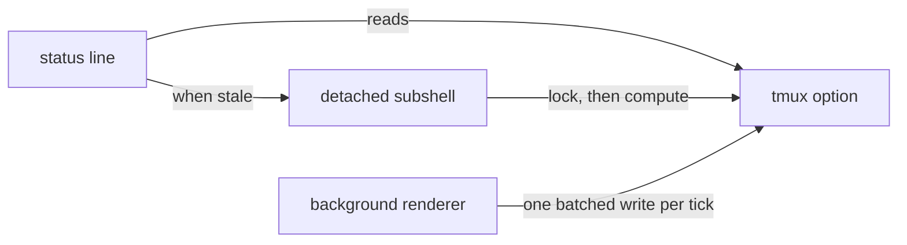

`revamped_cache_render` returns the stored option value. When the value is older than the age it was given, it sets a lock option and starts the refresh in a detached subshell, so a render never waits on the command. A lock older than 20 seconds counts as dead, so a refresh that crashed does not block the next one. All state is in tmux server options, so nothing is written to disk and it is gone when the server stops.

For plugins whose placeholders run often, `revamped_ticker_run` keeps one background process per server. It claims `@<prefix>_ticker_pid`, reads every option it needs in one tmux call per tick, renders, writes all values and the redraw in one more call, and exits when another process claims the option or the server stops.

<a id="screens"></a>

## Screens

<details>
<summary>Every screen, recorded inside a real tmux with <code>make screens</code>, with each key on the status line</summary>
<br>

<table>
<tr>
<td width="50%" valign="top">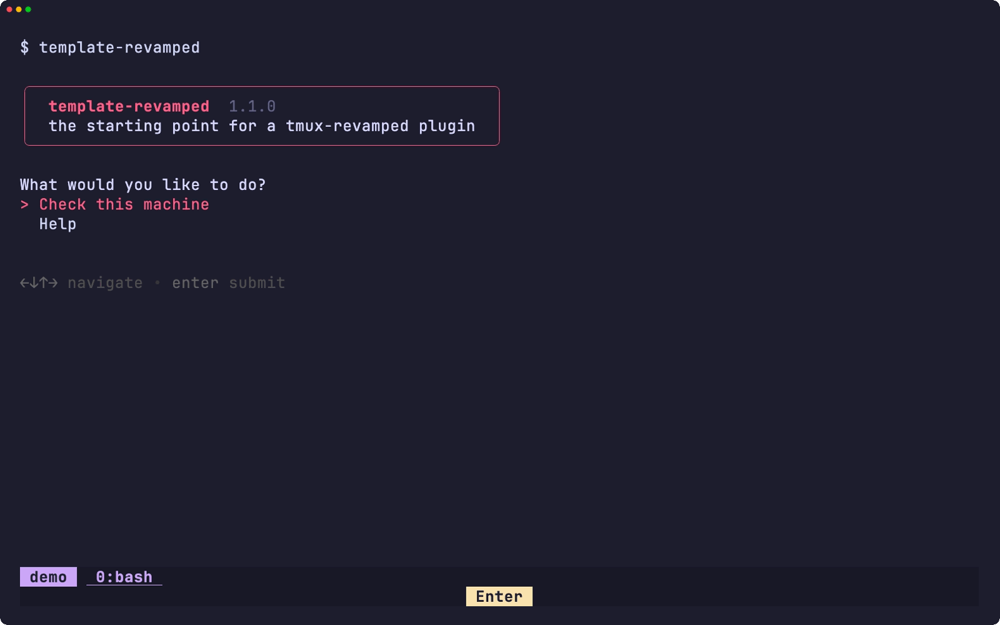<br><sub>The menu, from <code>hero.tape</code></sub></td>
<td width="50%" valign="top">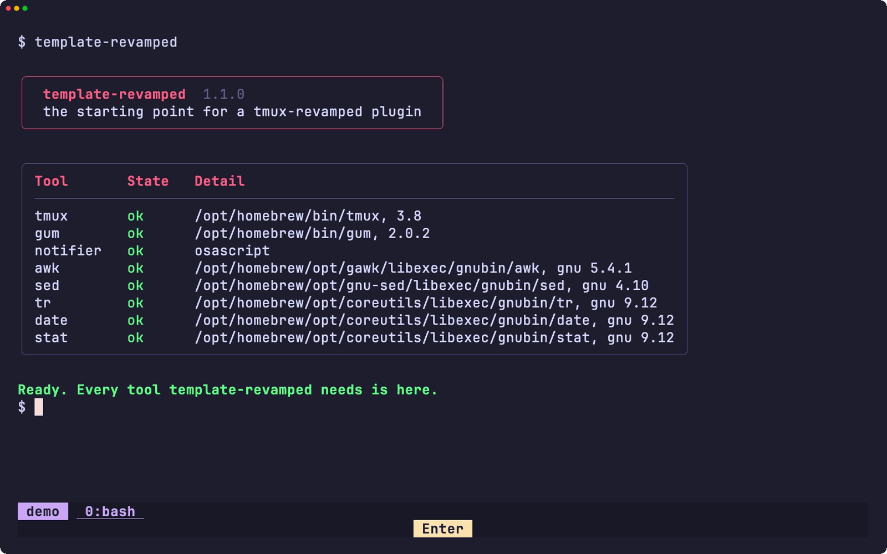<br><sub>doctor checks every tool, from <code>hero.tape</code></sub></td>
</tr>
<tr>
<td width="50%" valign="top">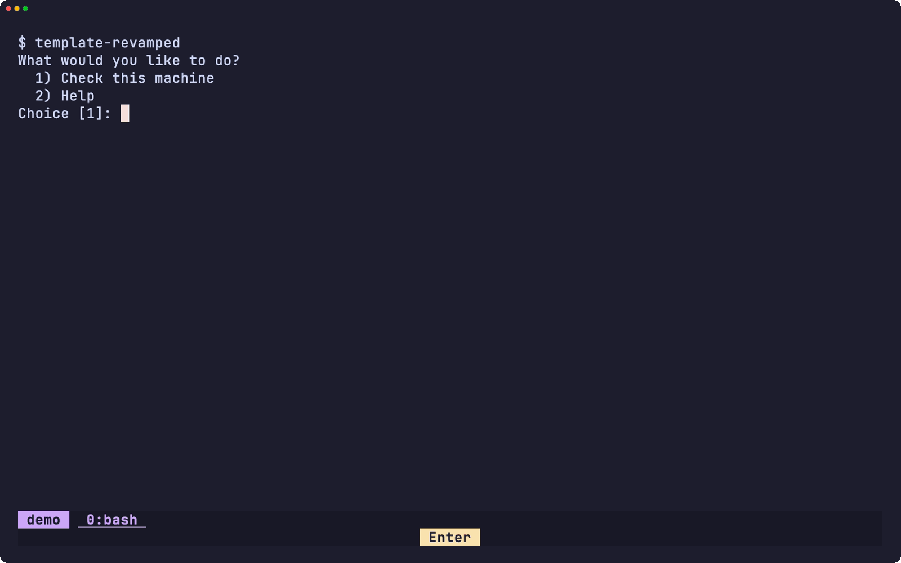<br><sub>The menu without gum, from <code>stills.tape</code></sub></td>
<td width="50%" valign="top">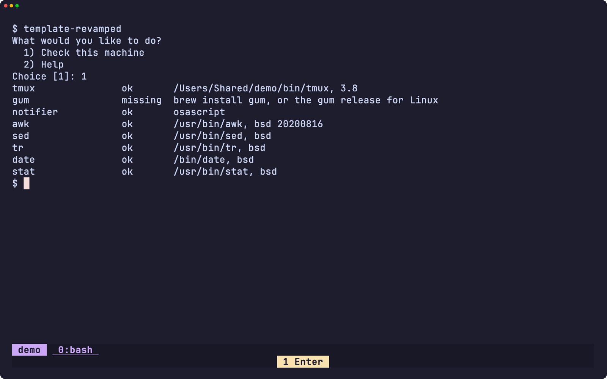<br><sub>doctor without gum, on the tools macOS ships, from <code>stills.tape</code></sub></td>
</tr>
<tr>
<td width="50%" valign="top">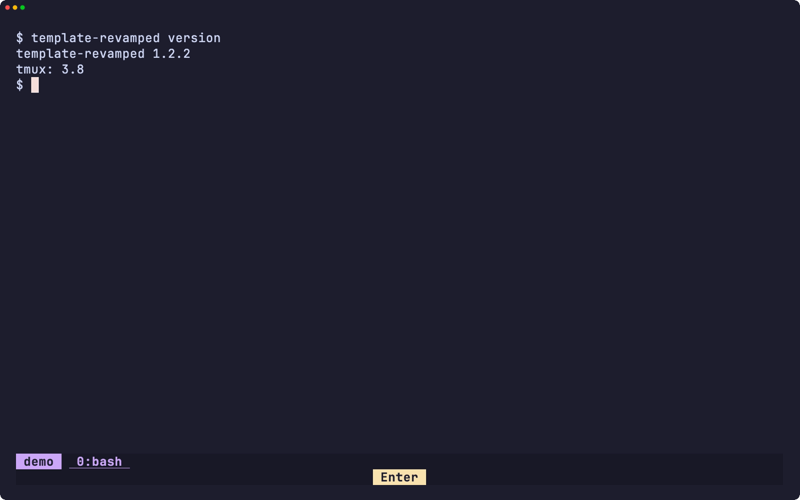<br><sub>The version, from <code>stills.tape</code></sub></td>
<td width="50%" valign="top">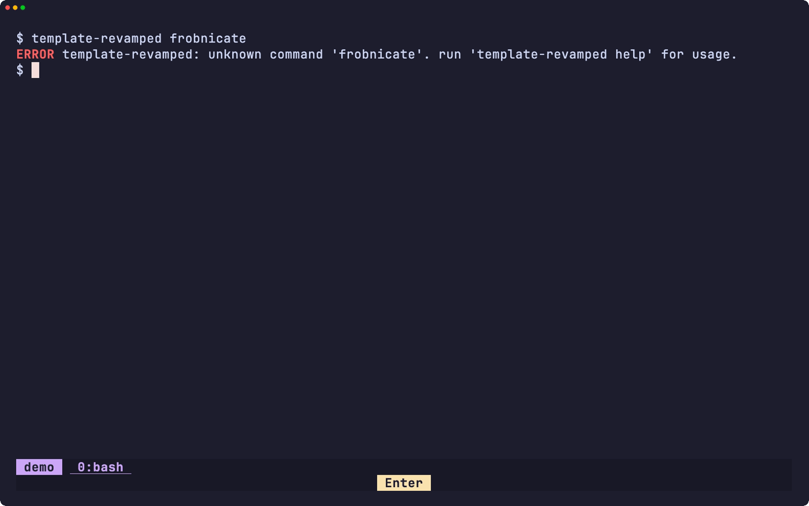<br><sub>An unknown command, from <code>stills.tape</code></sub></td>
</tr>
<tr>
<td width="50%" valign="top">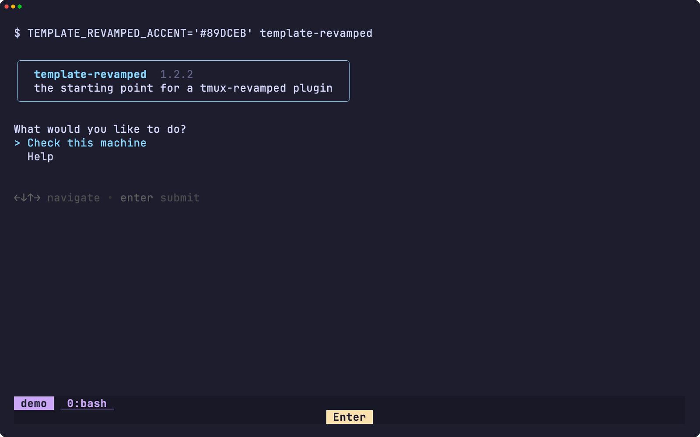<br><sub>An accent from <code>TEMPLATE_REVAMPED_ACCENT</code>, from <code>stills.tape</code></sub></td>
<td width="50%" valign="top">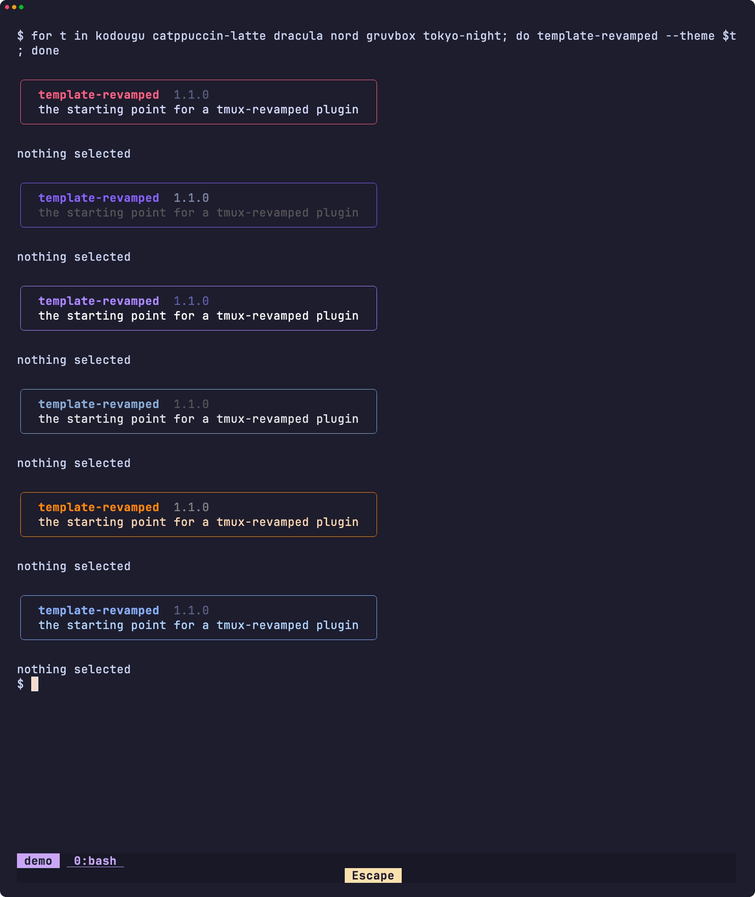<br><sub>The header in six themes, from <code>themes.tape</code></sub></td>
</tr>
<tr>
<td width="50%" valign="top">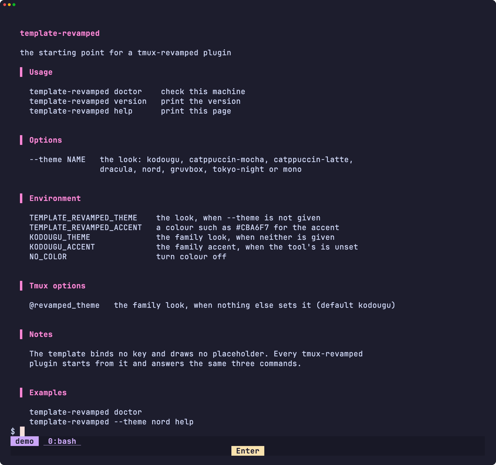<br><sub>The help page, from <code>help.tape</code></sub></td>
<td width="50%" valign="top"></td>
</tr>
</table>

</details>

## Portability

The library and the tool are POSIX `sh`. CI runs every suite on each row below.

| Shell | Status |
|:------|:-------|
| `dash`, `/bin/sh` on macOS | Supported |
| `bash` 3.2 and 5.x, the system's `zsh` and Homebrew's | Supported |

| System | Status |
|:-------|:-------|
| macOS | Tahoe on Apple Silicon and Intel, with the tools it ships, Homebrew's GNU tools and Homebrew's uutils |
| Linux | Ubuntu 26.04 on x86_64 and arm64, with GNU coreutils, uutils and BusyBox |
| FreeBSD, OpenBSD, NetBSD | Not covered by CI |

`template-revamped doctor` names the flavor and version of every core tool, such as `gnu 9.12`, `uutils 0.12.0` or `bsd 20200816`, so a bug report says which tools ran.

## Development

| Command | What it runs |
|:--------|:-------------|
| `make fmt` | shfmt `-i 2` on every script |
| `make lint` | shfmt, ShellCheck, mandoc, yamllint and actionlint, at zero findings |
| `make test` | The bats suites under the system `sh` |
| `make test-all` | The suites under every installed shell, both builds of bash and zsh on macOS |
| `make test-linux` | The suites in an Ubuntu container |
| `make coverage` | bashcov on this Mac and in the Ubuntu container, merged and gated at 100 percent |
| `make screens` | The screens above, recorded from the real tool inside tmux with VHS, on macOS |
| `make install` | The tool, its man page and completions under `PREFIX` |
| `make new-member NAME=<name>` | A new member, as under Starting a new plugin |

On macOS, `brew bundle` installs every tool these targets call, from the [`Brewfile`](Brewfile).

[`test/docs.bats`](test/docs.bats) fails when a relative link in this README points at a path that does not exist.

Commits follow the conventional commit format and go straight to `main`. After a green `ci` run on `main`, `release.yml` runs semantic-release: every `feat` or `fix` since the last tag publishes a release, stamps the version constant and adds the notes to [`CHANGELOG.md`](CHANGELOG.md).

## License

[MIT](LICENSE), copyright Gustavo Franco.

<!-- family:begin -->

## The tmux-revamped family

This plugin is one member of the tmux-revamped family. Every member carries the same contract in [`FAMILY.md`](FAMILY.md) and the same shared library, and they are built to be installed together: no member claims a key or a tmux option that another member claims.

A defect found in one member is hunted across all of them before the fix is called done.

| Member | What it does |
|---|---|
| [`tmux-autoreload-revamped`](https://github.com/tmux-revamped/tmux-autoreload-revamped) | Edit your tmux config, save, and watch it reload itself, no key, no command |
| [`tmux-battery-revamped`](https://github.com/tmux-revamped/tmux-battery-revamped) | Battery status for your tmux status bar, without ever blocking the status render |
| [`tmux-bluetooth-revamped`](https://github.com/tmux-revamped/tmux-bluetooth-revamped) | Every connected Bluetooth device and its battery in your tmux status bar, without blocking the render |
| [`tmux-cpu-revamped`](https://github.com/tmux-revamped/tmux-cpu-revamped) | CPU load, temperature, and frequency in your tmux status bar, without ever blocking the render |
| [`tmux-disk-revamped`](https://github.com/tmux-revamped/tmux-disk-revamped) | Disk usage for your tmux status bar, without ever blocking the status render |
| [`tmux-extract-revamped`](https://github.com/tmux-revamped/tmux-extract-revamped) | Pick a URL, path, hash or any other token off the screen with fzf and type it at the cursor, in pure shell |
| [`tmux-fzf-revamped`](https://github.com/tmux-revamped/tmux-fzf-revamped) | Switch to, kill, rename or create tmux sessions, windows and panes from fzf pickers in a popup |
| [`tmux-git-revamped`](https://github.com/tmux-revamped/tmux-git-revamped) | Show the active pane's git branch, changes and provider counts in the tmux status bar without blocking it |
| [`tmux-gpu-revamped`](https://github.com/tmux-revamped/tmux-gpu-revamped) | GPU load, temperature, clock, power and memory in the tmux status bar, from NVIDIA, AMD, Intel and Apple GPUs |
| [`tmux-kube-revamped`](https://github.com/tmux-revamped/tmux-kube-revamped) | Current Kubernetes context and namespace in the tmux status bar, parsed from kubeconfig without kubectl |
| [`tmux-launcher-revamped`](https://github.com/tmux-revamped/tmux-launcher-revamped) | Open any terminal app in a tmux popup, window or split from one menu, starting at the project root |
| [`tmux-logging-revamped`](https://github.com/tmux-revamped/tmux-logging-revamped) | Capture any pane to a file: live logging, full scrollback, or a one-shot screenshot |
| [`tmux-music-revamped`](https://github.com/tmux-revamped/tmux-music-revamped) | Now playing in your tmux status bar, without ever blocking the status render |
| [`tmux-network-revamped`](https://github.com/tmux-revamped/tmux-network-revamped) | Network throughput in your tmux status bar, without ever blocking the render |
| [`tmux-pain-control-revamped`](https://github.com/tmux-revamped/tmux-pain-control-revamped) | Pane and window management bindings for tmux, version aware, vim friendly, every prefix key can be disabled |
| [`tmux-persist-revamped`](https://github.com/tmux-revamped/tmux-persist-revamped) | Save every tmux session, window and pane, auto-save on a timer, and restore it all after a reboot |
| [`tmux-plugin-template`](https://github.com/tmux-revamped/tmux-plugin-template) | **this plugin**, The starting point for a tmux-revamped plugin: shared library, bats harness and CI |
| [`tmux-pomodoro-revamped`](https://github.com/tmux-revamped/tmux-pomodoro-revamped) | A Pomodoro timer in the tmux status bar that keeps all of its state in tmux options, with no temp files |
| [`tmux-ram-revamped`](https://github.com/tmux-revamped/tmux-ram-revamped) | RAM, swap and memory pressure in the tmux status bar, sampled in the background so the render never waits |
| [`tmux-reorder-revamped`](https://github.com/tmux-revamped/tmux-reorder-revamped) | Drag a window tab along the tmux status bar with the mouse to move that window |
| [`tmux-scroll-revamped`](https://github.com/tmux-revamped/tmux-scroll-revamped) | Send the mouse wheel to apps that scroll themselves and into tmux copy-mode everywhere else |
| [`tmux-sensible-revamped`](https://github.com/tmux-revamped/tmux-sensible-revamped) | Sensible tmux defaults, gated by tmux version and terminal, that leave the options you set alone |
| [`tmux-tiling-revamped`](https://github.com/tmux-revamped/tmux-tiling-revamped) | Tiling window management for tmux: eight layouts including BSP dwindle and spiral, with layout undo |
| [`tmux-time-revamped`](https://github.com/tmux-revamped/tmux-time-revamped) | Local and world clocks for the tmux status bar, colored by time of day, with countdowns and a DST warning |
| [`tmux-weather-revamped`](https://github.com/tmux-revamped/tmux-weather-revamped) | Weather for the tmux status bar from wttr.in, fetched in the background so the status line never waits |

<!-- family:end -->
