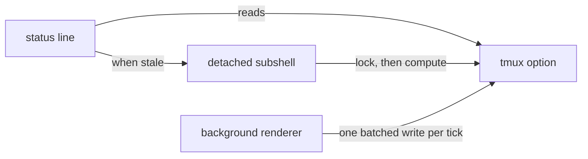

<div align="center">

# tmux-plugin-template

<strong>The starting point for a tmux-revamped plugin: shared library, bats harness and CI.</strong>

English &nbsp;|&nbsp; [日本語](README.ja.md) &nbsp;|&nbsp; [简体中文](README.zh-Hans.md) &nbsp;|&nbsp; [繁體中文（香港）](README.zh-HK.md)

[](https://github.com/tmux-revamped/tmux-plugin-template/actions/workflows/ci.yml)
[](https://github.com/tmux-revamped/tmux-plugin-template/releases/latest)
[](https://scorecard.dev/viewer/?uri=github.com/tmux-revamped/tmux-plugin-template)
[](LICENSE)

<p align="center">
  <a href="#what-it-does">What it does</a> &nbsp;|&nbsp;
  <a href="#requirements">Requirements</a> &nbsp;|&nbsp;
  <a href="#starting-a-new-plugin">Starting a new plugin</a> &nbsp;|&nbsp;
  <a href="#usage">Usage</a> &nbsp;|&nbsp;
  <a href="#configuration">Configuration</a> &nbsp;|&nbsp;
  <a href="#how-it-works">How it works</a>
</p>

</div>

**8** shared library modules. **10** family commands. **10** CI test jobs across Ubuntu and macOS, x86_64 and arm64.

---

## What it does

This repository is not a plugin you install. It is the base every `tmux-*-revamped` plugin starts from, and a member of the family itself, so its shared files stay identical to every other member's.

| Part | Path | What a new plugin gets |
|:-----|:-----|:-----------------------|
| Shared library | [`lib`](lib) | a status cache kept in tmux options, a background renderer, batched option writes, tmux option helpers, platform detection and an opt-in error log |
| Test harness | [`test`](test) | bats helpers with an in-memory tmux mock for unit tests and a private-socket tmux server for integration tests |
| CI and releases | [`.github/workflows`](.github/workflows) | `ci.yml` runs lint, the tests on Ubuntu and macOS with GNU, BSD and uutils tools, every shell and six toolsets, 100 percent bashcov coverage merged from both systems, and the security scans; `release.yml` publishes a release with semantic-release after a green push; `bot-merge.yml` merges a green Dependabot or Renovate pull request |
| Make targets | [`Makefile`](Makefile) | `fmt`, `lint`, `test`, `test-all`, `test-linux`, `coverage`, `check`, `clean` |

## Requirements

| Tool | Version | Used for |
|:-----|:--------|:---------|
| tmux | 3.2 or later | the family floor every member supports |
| A POSIX shell | any | the library runs under `sh`, `dash`, `bash` 3.2 and later and `zsh` |
| bats-core | any | `make test` |
| shfmt, shellcheck, yamllint and actionlint | any | `make lint` |
| Docker | any | `make test-linux` and `make coverage`, which run in an Ubuntu container |
| Ruby 4.0.9 and Bundler | as pinned | `make coverage`, after `bundle install` |
| dash and zsh | any | `make test-all` |

## Starting a new plugin

1. Copy the template under the new name and point it at the new repository:

   ```bash
   git clone https://github.com/tmux-revamped/tmux-plugin-template tmux-example-revamped
   cd tmux-example-revamped
   git remote set-url origin https://github.com/tmux-revamped/tmux-example-revamped.git
   ```

2. Add the entry point `example-revamped.tmux` at the root. TPM runs every `*.tmux` file in a plugin directory. Put the plugin logic in `lib/example.sh` and its own modules under `lib/`. [tmux-time-revamped](https://github.com/tmux-revamped/tmux-time-revamped) is a complete status plugin built this way.
3. Rename `TMUX_PLUGIN_TEMPLATE_VERSION` in [`lib/core.sh`](lib/core.sh) to `EXAMPLE_REVAMPED_VERSION`. A release stamps it and writes the notes to [`CHANGELOG.md`](CHANGELOG.md).
4. Name every tmux option `@example_revamped_<name>`, and document every one in [`README.md`](README.md).
5. Pick at most one default key from the allocation under Key bindings in [`FAMILY.md`](FAMILY.md), and leave every other action unbound by default.
6. Add the repository to the member table and the `cmp` loop in [`FAMILY.md`](FAMILY.md), and to the family section of every README, in every member in the same task.
7. Write the README with the same header as this one, and copy the section between the `family:begin` and `family:end` markers from another member, marking this plugin's row.
8. Run the gates in the Development section until all of them exit 0.

Every file [`FAMILY.md`](FAMILY.md) lists as identical stays the same in every member. Change one only by changing it in every member in the same task.

## Usage

A status plugin sources the cache and renders from it. The status line gets the stored value at once, and a stale value is recomputed in a detached subshell:

```sh
#!/bin/sh

REVAMPED_LIB="$(cd "$(dirname "$0")/../lib" && pwd)"
REVAMPED_CACHE_PREFIX=example_revamped
. "${REVAMPED_LIB}/cache.sh"

read_load() { uptime; }

revamped_cache_render load 5 read_load
```

| Module | Functions |
|:-------|:----------|
| [`lib/cache.sh`](lib/cache.sh) | `revamped_cache_render`, `revamped_cache_get`, `revamped_cache_set`, `revamped_cache_age`, `revamped_cache_is_fresh`, `revamped_cache_refresh_if_stale`, `revamped_cache_set_if_stale` |
| [`lib/ticker.sh`](lib/ticker.sh) | `revamped_ticker_start`, `revamped_ticker_run`, `revamped_ticker_interval` for one background renderer per server |
| [`lib/publish.sh`](lib/publish.sh) | `revamped_publish_add`, `revamped_publish_commit` for batched option writes, `revamped_publish_escape` to double every `#`, `revamped_publish_pad` and `revamped_publish_width` for fixed widths |
| [`lib/tmux.sh`](lib/tmux.sh) | `revamped_tmux_get`, `revamped_tmux_set`, `revamped_tmux_unset`, window and pane option helpers, pane and window size getters |
| [`lib/platform.sh`](lib/platform.sh) | `revamped_platform_os`, `revamped_platform_arch`, `revamped_is_macos`, `revamped_is_linux`, `revamped_is_bsd`, `revamped_is_apple_silicon`, each computed once per process |
| [`lib/command.sh`](lib/command.sh) | `revamped_has_command` |
| [`lib/log.sh`](lib/log.sh) | `revamped_log_error` |
| [`lib/core.sh`](lib/core.sh) | the version constant and shared defaults |

Any text that comes from outside the user's config, such as a process name, a network response or a file name, goes through `revamped_publish_escape` before it reaches the status line, so it cannot run as a tmux format.

## Configuration

The template binds no key and reads no option of its own. The library reads these options under the prefix a plugin chooses:

| Option | Read by | Meaning |
|:-------|:--------|:--------|
| `@<prefix>_<key>` | cache | a cached value, with `_ts` for its age and `_lock` while a refresh runs |
| `@<prefix>_interval` | ticker | `minute`, or seconds between background renders. Anything else falls back to `status-interval`, then 5 |
| `@<prefix>_ticker_pid` | ticker | the process that owns the background renderer |
| `@<prefix>_fixed_width` | publish | `on` pads a value to its natural width |
| `@<prefix>_<metric>_width` | publish | explicit width for one value |
| `@<namespace>_enable_logging` | error log | `1` writes to `~/.tmux/<namespace>-logs/<namespace>.log`, rotated past 1 MB |

`<prefix>` is `REVAMPED_CACHE_PREFIX` for the cache and the argument passed to the ticker and publish functions. `<namespace>` is `REVAMPED_LOG_NS` with `-` turned into `_`.

## How it works



`revamped_cache_render` returns the stored option value. When the value is older than the age it was given, it sets a lock option and starts the refresh in a detached subshell, so a render never waits on the command. A lock older than 20 seconds counts as dead, so a refresh that crashed does not block the next one. All state is in tmux server options, so nothing is written to disk and it is gone when the server stops.

For plugins whose placeholders run often, `revamped_ticker_run` keeps one background process per server. It claims `@<prefix>_ticker_pid`, reads every option it needs in one tmux call per tick, renders, writes all values and the redraw in one more call, and exits when another process claims the option or the server stops.

## Development

| Command | What it runs |
|:--------|:-------------|
| `make fmt` | shfmt `-i 2` on every script |
| `make lint` | shfmt, shellcheck, yamllint and actionlint, at zero findings |
| `make test` | the bats suite |
| `make test-all` | the bats suite once with every installed bash and zsh as the login shell |
| `make test-linux` | the bats suite in an Ubuntu container |
| `make coverage` | bashcov on this Mac and in an Ubuntu container, merged and gated at 100 percent |

[`test/docs.bats`](test/docs.bats) fails when a relative link in this README points at a path that does not exist.

Commits follow the conventional commit format and go straight to `main`. After a green `ci` run on `main`, `release.yml` runs semantic-release: every `feat` or `fix` since the last tag publishes a release, stamps the version constant and adds the notes to [`CHANGELOG.md`](CHANGELOG.md).

## License

[MIT](LICENSE), copyright Gustavo Franco.

<!-- family:begin -->

## The tmux-revamped family

This plugin is one member of the tmux-revamped family. Every member carries the same contract in [`FAMILY.md`](FAMILY.md) and the same shared library, and they are built to be installed together: no member claims a key or a tmux option that another member claims.

A defect found in one member is hunted across all of them before the fix is called done.

| Member | What it does |
|---|---|
| [`tmux-autoreload-revamped`](https://github.com/tmux-revamped/tmux-autoreload-revamped) | Edit your tmux config, save, and watch it reload itself, no key, no command |
| [`tmux-battery-revamped`](https://github.com/tmux-revamped/tmux-battery-revamped) | Battery status for your tmux status bar, without ever blocking the status render |
| [`tmux-bluetooth-revamped`](https://github.com/tmux-revamped/tmux-bluetooth-revamped) | Every connected Bluetooth device and its battery in your tmux status bar, without blocking the render |
| [`tmux-cpu-revamped`](https://github.com/tmux-revamped/tmux-cpu-revamped) | CPU load, temperature, and frequency in your tmux status bar, without ever blocking the render |
| [`tmux-disk-revamped`](https://github.com/tmux-revamped/tmux-disk-revamped) | Disk usage for your tmux status bar, without ever blocking the status render |
| [`tmux-extract-revamped`](https://github.com/tmux-revamped/tmux-extract-revamped) | Pick a URL, path, hash or any other token off the screen with fzf and type it at the cursor, in pure shell |
| [`tmux-fzf-revamped`](https://github.com/tmux-revamped/tmux-fzf-revamped) | Switch to, kill, rename or create tmux sessions, windows and panes from fzf pickers in a popup |
| [`tmux-git-revamped`](https://github.com/tmux-revamped/tmux-git-revamped) | Show the active pane's git branch, changes and provider counts in the tmux status bar without blocking it |
| [`tmux-gpu-revamped`](https://github.com/tmux-revamped/tmux-gpu-revamped) | GPU load, temperature, clock, power and memory in the tmux status bar, from NVIDIA, AMD, Intel and Apple GPUs |
| [`tmux-kube-revamped`](https://github.com/tmux-revamped/tmux-kube-revamped) | Current Kubernetes context and namespace in the tmux status bar, parsed from kubeconfig without kubectl |
| [`tmux-launcher-revamped`](https://github.com/tmux-revamped/tmux-launcher-revamped) | Launch any TUI app in a popup or a window, scoped to the current pane's directory, with one configurable bindi |
| [`tmux-logging-revamped`](https://github.com/tmux-revamped/tmux-logging-revamped) | Capture any pane to a file: live logging, full scrollback, or a one-shot screenshot |
| [`tmux-music-revamped`](https://github.com/tmux-revamped/tmux-music-revamped) | Now playing in your tmux status bar, without ever blocking the status render |
| [`tmux-network-revamped`](https://github.com/tmux-revamped/tmux-network-revamped) | Network throughput in your tmux status bar, without ever blocking the render |
| [`tmux-pain-control-revamped`](https://github.com/tmux-revamped/tmux-pain-control-revamped) | Pane and window management bindings for tmux, version aware, vim friendly, every prefix key can be disabled |
| [`tmux-persist-revamped`](https://github.com/tmux-revamped/tmux-persist-revamped) | Save every tmux session, window and pane, auto-save on a timer, and restore it all after a reboot |
| [`tmux-plugin-template`](https://github.com/tmux-revamped/tmux-plugin-template) | **this plugin**, The starting point for a tmux-revamped plugin: shared library, bats harness and CI |
| [`tmux-pomodoro-revamped`](https://github.com/tmux-revamped/tmux-pomodoro-revamped) | A Pomodoro timer in the tmux status bar that keeps all of its state in tmux options, with no temp files |
| [`tmux-ram-revamped`](https://github.com/tmux-revamped/tmux-ram-revamped) | RAM, swap and memory pressure in the tmux status bar, sampled in the background so the render never waits |
| [`tmux-reorder-revamped`](https://github.com/tmux-revamped/tmux-reorder-revamped) | Drag a window tab along the tmux status bar with the mouse to move that window |
| [`tmux-scroll-revamped`](https://github.com/tmux-revamped/tmux-scroll-revamped) | Send the mouse wheel to apps that scroll themselves and into tmux copy-mode everywhere else |
| [`tmux-sensible-revamped`](https://github.com/tmux-revamped/tmux-sensible-revamped) | Sensible tmux defaults, gated by tmux version and terminal, that leave the options you set alone |
| [`tmux-tiling-revamped`](https://github.com/tmux-revamped/tmux-tiling-revamped) | Tiling window management for tmux: eight layouts including BSP dwindle and spiral, with layout undo |
| [`tmux-time-revamped`](https://github.com/tmux-revamped/tmux-time-revamped) | Local and world clocks for the tmux status bar, colored by time of day, with countdowns and a DST warning |
| [`tmux-weather-revamped`](https://github.com/tmux-revamped/tmux-weather-revamped) | Weather for the tmux status bar from wttr.in, fetched in the background so the status line never waits |

<!-- family:end -->
