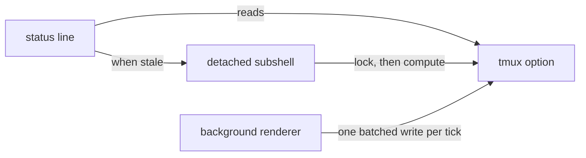

<div align="center">

# tmux-plugin-template

<strong>The starting point for a tmux-revamped plugin: shared library, bats harness, CI and family tooling.</strong>

English &nbsp;|&nbsp; [日本語](README.ja.md) &nbsp;|&nbsp; [简体中文](README.zh-Hans.md) &nbsp;|&nbsp; [繁體中文（香港）](README.zh-HK.md)

[](https://github.com/tmux-revamped/tmux-plugin-template/actions/workflows/family.yml)
[](https://github.com/tmux-revamped/tmux-plugin-template/actions/workflows/tests.yml)
[](https://github.com/tmux-revamped/tmux-plugin-template/releases/latest)
[](https://scorecard.dev/viewer/?uri=github.com/tmux-revamped/tmux-plugin-template)
[](LICENSE)

<p align="center">
  <a href="#what-it-does">What it does</a> &nbsp;|&nbsp;
  <a href="#requirements">Requirements</a> &nbsp;|&nbsp;
  <a href="#starting-a-new-plugin">Starting a new plugin</a> &nbsp;|&nbsp;
  <a href="#usage">Usage</a> &nbsp;|&nbsp;
  <a href="#configuration">Configuration</a> &nbsp;|&nbsp;
  <a href="#how-it-works">How it works</a>
</p>

</div>

**8** shared library modules. **10** family commands. **10** CI test jobs across Ubuntu and macOS, x86_64 and arm64.

---

## What it does

This repository is not a plugin you install. It is the base every `tmux-*-revamped` plugin starts from, and a member of the family itself, so its shared files stay identical to every other member's.

| Part | Path | What a new plugin gets |
|:-----|:-----|:-----------------------|
| Shared library | [`src/lib`](src/lib) | a status cache kept in tmux options, a background renderer, batched option writes, tmux option helpers, platform detection and an opt-in error log |
| Test harness | [`test`](test) | bats helpers with an in-memory tmux mock for unit tests and a private-socket tmux server for integration tests |
| CI | [`.github/workflows`](.github/workflows) | tests on Ubuntu and macOS with GNU, BSD and uutils tools, shellcheck, actionlint, a 95 percent kcov floor, version checks, a release per new version, and a weekly family check |
| Family tooling | [`family/bin`](family/bin) | audit, sync, propagate, sweep, doctor and README generation for the family contract in [`FAMILY.md`](FAMILY.md) |
| Make targets | [`Makefile`](Makefile) | `test`, `test-unit`, `coverage`, `lint`, `clean` |

## Requirements

| Tool | Version | Used for |
|:-----|:--------|:---------|
| tmux | 3.2 or later | the family floor every member supports |
| bash | 3.2 or later | the library and the tests run on macOS `/bin/bash` |
| bats-core | any | `make test` |
| shellcheck | any | `make lint` |
| kcov and python3 | any | `make coverage`, Linux only |

## Starting a new plugin

1. Copy the template under the new name and point it at the new repository:

   ```bash
   git clone https://github.com/tmux-revamped/tmux-plugin-template tmux-example-revamped
   cd tmux-example-revamped
   git remote set-url origin https://github.com/tmux-revamped/tmux-example-revamped.git
   ```

2. Add the entry point `example-revamped.tmux` at the root. TPM runs every `*.tmux` file in a plugin directory. Put the plugin logic in `src/example.sh` and its own modules under `src/lib/example/`. [tmux-time-revamped](https://github.com/tmux-revamped/tmux-time-revamped) is a complete status plugin built this way.
3. Rename `TMUX_PLUGIN_TEMPLATE_VERSION` in [`src/lib/utils/constants.sh`](src/lib/utils/constants.sh) to `EXAMPLE_REVAMPED_VERSION`. The CI `version` job fails unless that constant, the first versioned heading of [`CHANGELOG.md`](CHANGELOG.md) and the `version-X.Y.Z` badge in the README agree.
4. Name every tmux option `@example_revamped_<name>`. The CI lint job takes the slug from the directory name and fails when an option under [`src/`](src) is missing from [`README.md`](README.md).
5. Pick at most one default key from the allocation in [`family/KEYS.md`](family/KEYS.md), and leave every other action unbound by default.
6. Add the repository to [`family/MEMBERS`](family/MEMBERS). Both files are owned, so change them in one member and run `family/bin/propagate --message 'chore(family): add tmux-example-revamped'`, which copies them to every member and opens the pull requests.
7. Write the README with the same header as this one and keep the `family:begin` and `family:end` markers. [`family/bin/gen-readme`](family/bin/gen-readme) fills the section between them from the member list in [`family/MEMBERS`](family/MEMBERS) and the tagline of each member.
8. Run the gates in the Development section until all of them exit 0.

Every file listed as `owned` in [`family/OWNERSHIP`](family/OWNERSHIP) stays byte-identical across members. Edit those only through [`family/bin/propagate`](family/bin/propagate).

## Usage

A status plugin sources the cache and renders from it. The status line gets the stored value at once, and a stale value is recomputed in a detached subshell:

```bash
#!/usr/bin/env bash

PLUGIN_DIR="$(cd "$(dirname "${BASH_SOURCE[0]}")/.." && pwd)"
export CACHE_PREFIX="example_revamped"
source "${PLUGIN_DIR}/src/lib/utils/cache.sh"

read_load() { uptime; }

cache_render load 5 read_load
```

| Module | Functions |
|:-------|:----------|
| [`src/lib/utils/cache.sh`](src/lib/utils/cache.sh) | `cache_render`, `cache_get`, `cache_set`, `cache_age`, `cache_is_fresh`, `cache_refresh_if_stale`, `cache_set_if_stale` |
| [`src/lib/utils/ticker.sh`](src/lib/utils/ticker.sh) | `ticker_start`, `ticker_run`, `ticker_interval` for one background renderer per server |
| [`src/lib/utils/publish.sh`](src/lib/utils/publish.sh) | `publish_add`, `publish_commit` for batched option writes, `publish_escape` to double every `#`, `publish_pad` and `publish_width` for fixed widths |
| [`src/lib/tmux/tmux-ops.sh`](src/lib/tmux/tmux-ops.sh) | `get_tmux_option`, `set_tmux_option`, `unset_tmux_option`, window and pane option helpers, pane and window size getters |
| [`src/lib/utils/platform.sh`](src/lib/utils/platform.sh) | `platform_os`, `platform_arch`, `is_macos`, `is_linux`, `is_bsd`, `is_apple_silicon`, each computed once per process |
| [`src/lib/utils/has-command.sh`](src/lib/utils/has-command.sh) | `has_command` |
| [`src/lib/utils/error-logger.sh`](src/lib/utils/error-logger.sh) | `log_error` |
| [`src/lib/utils/constants.sh`](src/lib/utils/constants.sh) | the version constant and shared defaults |

Any text that comes from outside the user's config, such as a process name, a network response or a file name, goes through `publish_escape` before it reaches the status line, so it cannot run as a tmux format.

## Configuration

The template binds no key and reads no option of its own. The library reads these options under the prefix a plugin chooses:

| Option | Read by | Meaning |
|:-------|:--------|:--------|
| `@<prefix>_<key>` | cache | a cached value, with `_ts` for its age and `_lock` while a refresh runs |
| `@<prefix>_interval` | ticker | `minute`, or seconds between background renders. Anything else falls back to `status-interval`, then 5 |
| `@<prefix>_ticker_pid` | ticker | the process that owns the background renderer |
| `@<prefix>_fixed_width` | publish | `on` pads a value to its natural width |
| `@<prefix>_<metric>_width` | publish | explicit width for one value |
| `@<namespace>_enable_logging` | error log | `1` writes to `~/.tmux/<namespace>-logs/<namespace>.log`, rotated past 1 MB |

`<prefix>` is `CACHE_PREFIX` for the cache and the argument passed to the ticker and publish functions. `<namespace>` is `PLUGIN_LOG_NS` with `-` turned into `_`.

## How it works



`cache_render` returns the stored option value. When the value is older than the age it was given, it sets a lock option and starts the refresh in a detached subshell, so a render never waits on the command. A lock older than 20 seconds counts as dead, so a refresh that crashed does not block the next one. All state is in tmux server options, so nothing is written to disk and it is gone when the server stops.

For plugins whose placeholders run often, `ticker_run` keeps one background process per server. It claims `@<prefix>_ticker_pid`, reads every option it needs in one tmux call per tick, renders, writes all values and the redraw in one more call, and exits when another process claims the option or the server stops.

## Development

| Command | What it runs |
|:--------|:-------------|
| `make test` | the bats suite |
| `make test-unit` | the unit tests under [`test/lib`](test/lib) |
| `make lint` | shellcheck at warning level on every shell file and every family command |
| `make coverage` | kcov line coverage with a 95 percent floor, Linux only |
| [`family/bin/audit`](family/bin/audit) | this repository against the family contract |

[`test/docs.bats`](test/docs.bats) fails when a relative link in this README points at a path that does not exist.

## License

[MIT](LICENSE), copyright Gustavo Franco.

<!-- family:begin -->

## The tmux-revamped family

This plugin is one member of the tmux-revamped family. Every member carries the
same contract in [`FAMILY.md`](FAMILY.md), the same tooling under `family/`, and
the same shared library, all held byte-identical by a checksum manifest. They are
built to be installed together: no member claims a key or a tmux option that
another member claims.

A defect found in one member is hunted across all of them before the fix is
called done. That obligation is written into the contract rather than left to
memory, and `family/bin/sweep` is how it is discharged.

| Member | What it does |
|---|---|
| [`tmux-autoreload-revamped`](https://github.com/tmux-revamped/tmux-autoreload-revamped) | Edit your tmux config, save, and watch it reload itself, no key, no command |
| [`tmux-battery-revamped`](https://github.com/tmux-revamped/tmux-battery-revamped) | Battery status for your tmux status bar, without ever blocking the status render |
| [`tmux-bluetooth-revamped`](https://github.com/tmux-revamped/tmux-bluetooth-revamped) | Every connected Bluetooth device and its battery in your tmux status bar, without blocking the render |
| [`tmux-cpu-revamped`](https://github.com/tmux-revamped/tmux-cpu-revamped) | CPU load, temperature, and frequency in your tmux status bar, without ever blocking the render |
| [`tmux-disk-revamped`](https://github.com/tmux-revamped/tmux-disk-revamped) | Disk usage for your tmux status bar, without ever blocking the status render |
| [`tmux-extract-revamped`](https://github.com/tmux-revamped/tmux-extract-revamped) | Pick a URL, path, hash or any other token off the screen with fzf and type it at the cursor, in pure shell |
| [`tmux-fzf-revamped`](https://github.com/tmux-revamped/tmux-fzf-revamped) | Switch to, kill, rename or create tmux sessions, windows and panes from fzf pickers in a popup |
| [`tmux-git-revamped`](https://github.com/tmux-revamped/tmux-git-revamped) | Show the active pane's git branch, changes and provider counts in the tmux status bar without blocking it |
| [`tmux-gpu-revamped`](https://github.com/tmux-revamped/tmux-gpu-revamped) | GPU load, temperature, clock, power and memory in the tmux status bar, from NVIDIA, AMD, Intel and Apple GPUs |
| [`tmux-kube-revamped`](https://github.com/tmux-revamped/tmux-kube-revamped) | Current Kubernetes context and namespace in the tmux status bar, parsed from kubeconfig without kubectl |
| [`tmux-launcher-revamped`](https://github.com/tmux-revamped/tmux-launcher-revamped) | Launch any TUI app in a popup or a window, scoped to the current pane's directory, with one configurable bindi |
| [`tmux-logging-revamped`](https://github.com/tmux-revamped/tmux-logging-revamped) | Capture any pane to a file: live logging, full scrollback, or a one-shot screenshot |
| [`tmux-music-revamped`](https://github.com/tmux-revamped/tmux-music-revamped) | Now playing in your tmux status bar, without ever blocking the status render |
| [`tmux-network-revamped`](https://github.com/tmux-revamped/tmux-network-revamped) | Network throughput in your tmux status bar, without ever blocking the render |
| [`tmux-pain-control-revamped`](https://github.com/tmux-revamped/tmux-pain-control-revamped) | Pane and window management bindings for tmux, version aware, vim friendly, every prefix key can be disabled |
| [`tmux-persist-revamped`](https://github.com/tmux-revamped/tmux-persist-revamped) | Save every tmux session, window and pane, auto-save on a timer, and restore it all after a reboot |
| [`tmux-plugin-template`](https://github.com/tmux-revamped/tmux-plugin-template) | **this plugin**, The starting point for a tmux-revamped plugin: shared library, bats harness, CI and family tooling |
| [`tmux-pomodoro-revamped`](https://github.com/tmux-revamped/tmux-pomodoro-revamped) | A Pomodoro timer in the tmux status bar that keeps all of its state in tmux options, with no temp files |
| [`tmux-ram-revamped`](https://github.com/tmux-revamped/tmux-ram-revamped) | RAM, swap and memory pressure in the tmux status bar, sampled in the background so the render never waits |
| [`tmux-reorder-revamped`](https://github.com/tmux-revamped/tmux-reorder-revamped) | Drag a window tab along the tmux status bar with the mouse to move that window |
| [`tmux-scroll-revamped`](https://github.com/tmux-revamped/tmux-scroll-revamped) | Send the mouse wheel to apps that scroll themselves and into tmux copy-mode everywhere else |
| [`tmux-sensible-revamped`](https://github.com/tmux-revamped/tmux-sensible-revamped) | Sensible tmux defaults, gated by tmux version and terminal, that leave the options you set alone |
| [`tmux-tiling-revamped`](https://github.com/tmux-revamped/tmux-tiling-revamped) | Tiling window management for tmux: eight layouts including BSP dwindle and spiral, with layout undo |
| [`tmux-time-revamped`](https://github.com/tmux-revamped/tmux-time-revamped) | Local and world clocks for the tmux status bar, colored by time of day, with countdowns and a DST warning |
| [`tmux-weather-revamped`](https://github.com/tmux-revamped/tmux-weather-revamped) | Weather for the tmux status bar from wttr.in, fetched in the background so the status line never waits |

### Checking an installation

With every member on disk, one command reports any conflict between them:

```sh
family/bin/doctor --live
```

It reads each member and the running tmux server, and reports duplicate keys,
duplicate status placeholders, options outside the naming grammar, and any
member whose contract version has fallen behind.

<!-- family:end -->
