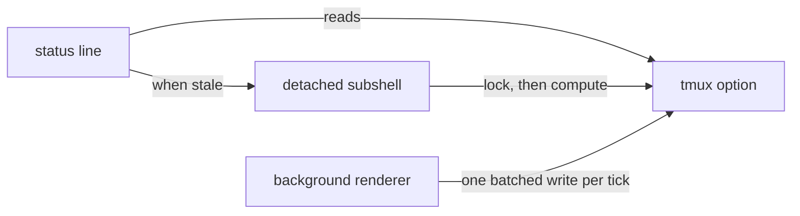
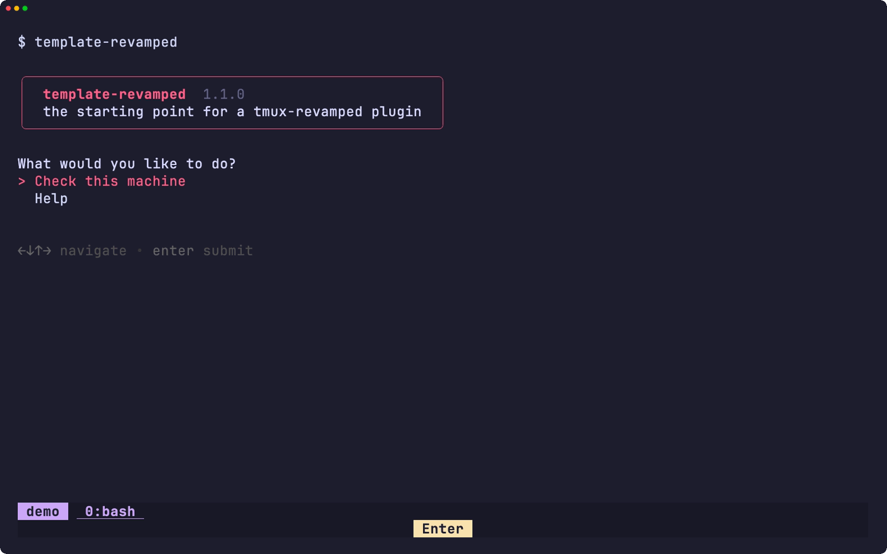
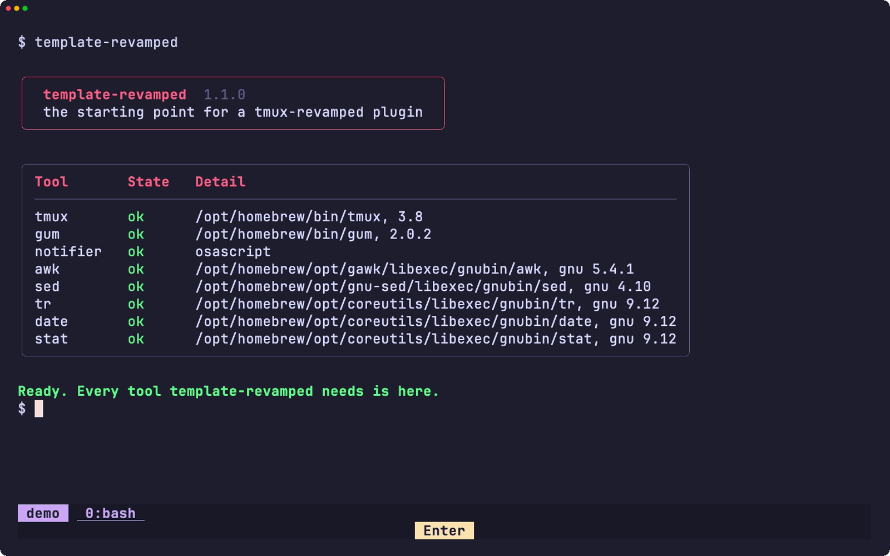
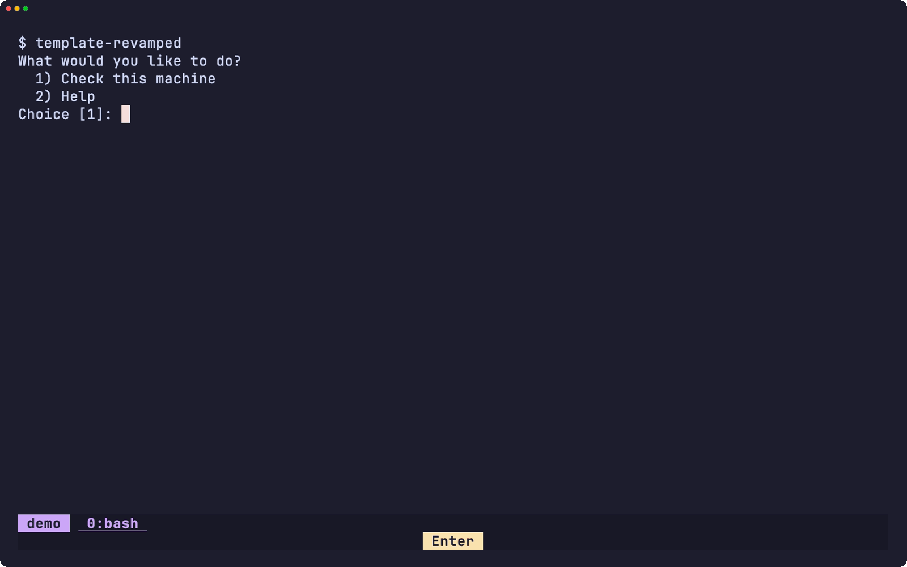
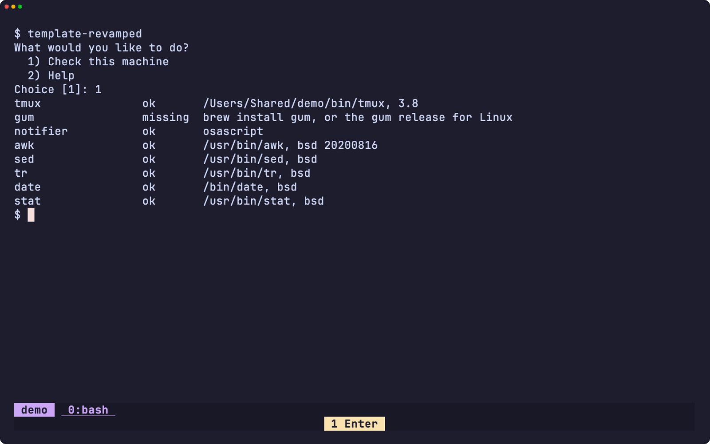
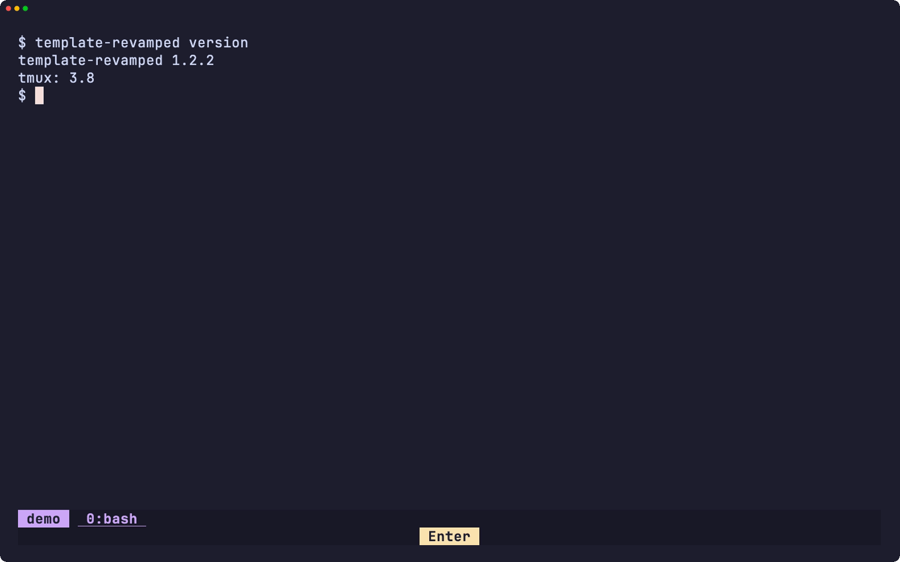
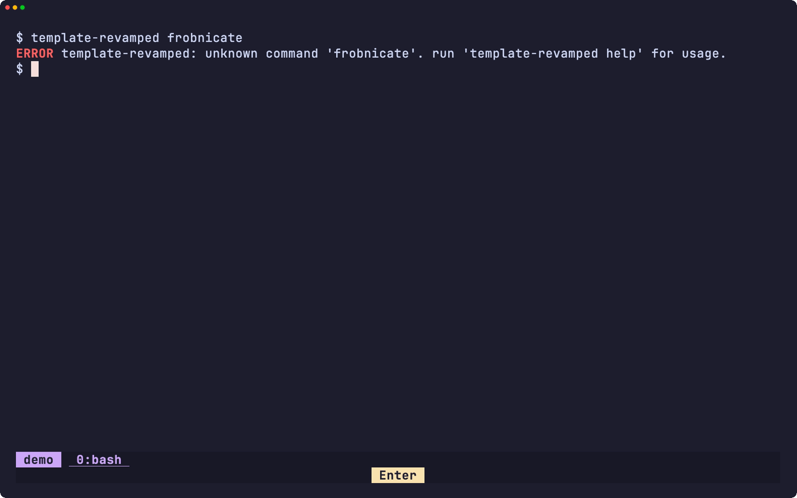
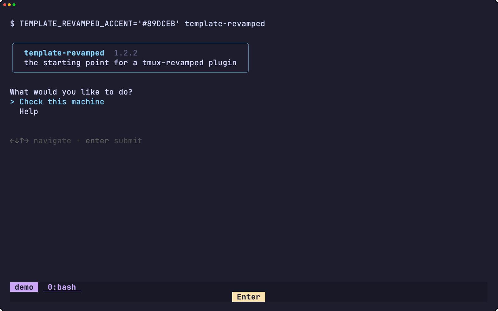
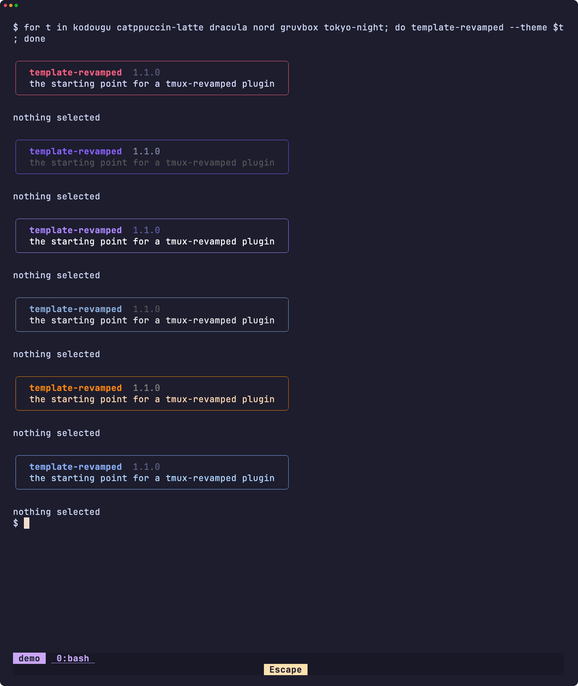
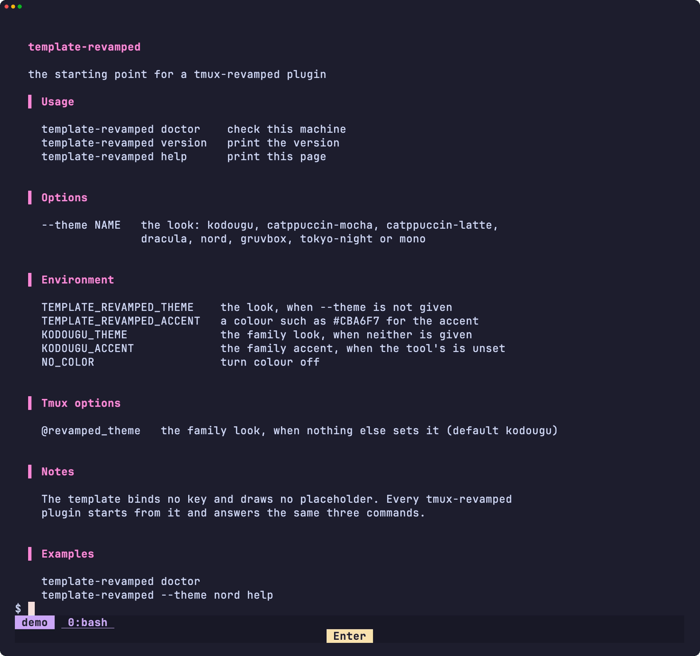

<div align="center">

# tmux-plugin-template

<strong>tmux-revamped 插件的起點：共用程式庫、bats 測試框架和 CI。</strong>

[English](README.md) &nbsp;|&nbsp; [日本語](README.ja.md) &nbsp;|&nbsp; [简体中文](README.zh-Hans.md) &nbsp;|&nbsp; 繁體中文（香港）

[](https://github.com/tmux-revamped/tmux-plugin-template/actions/workflows/ci.yml)
[](https://github.com/tmux-revamped/tmux-plugin-template/releases/latest)
[](https://scorecard.dev/viewer/?uri=github.com/tmux-revamped/tmux-plugin-template)
[](LICENSE)

<p align="center">
  <a href="#快速開始"><strong>快速開始</strong></a> &nbsp;|&nbsp;
  <a href="#用法">用法</a> &nbsp;|&nbsp;
  <a href="#開始一個新插件">開始一個新插件</a> &nbsp;|&nbsp;
  <a href="#共用程式庫">共用程式庫</a> &nbsp;|&nbsp;
  <a href="#畫面">畫面</a>
</p>

</div>

<p align="center">
  
</p>

```console
$ template-revamped doctor | cat
tmux               ok       /opt/homebrew/bin/tmux, 3.8
gum                ok       /opt/homebrew/bin/gum, 2.0.2
notifier           ok       osascript
awk                ok       /usr/bin/awk, bsd 20200816
sed                ok       /usr/bin/sed, bsd
tr                 ok       /usr/bin/tr, bsd
date               ok       /bin/date, bsd
stat               ok       /usr/bin/stat, bsd
```

本儲存庫不是裝進 tmux 使用的插件。它是每個 `tmux-*-revamped` 插件的起點，本身亦是系列的成員，因此其共用檔案與其他所有成員保持一致。它附有 `template-revamped` 指令，每個成員都以自己的名稱提供同樣的指令：`doctor`、`version`、`help` 和一個選單。

---

## 快速開始

### 前提條件

| 工具 | 版本 | 用途 |
|:-----|:--------|:---------|
| tmux | 3.2 或以上 | 所有成員都支援的系列下限 |
| POSIX shell | 任何 | `sh`、`dash`、`bash` 3.2 或以上版本和 `zsh` |
| gum | 可選 | 選單、表格和顏色；沒有它時每個指令都輸出純文字 |
| git 和 make | 任何 | 複製和安裝 |

### 安裝

```bash
git clone https://github.com/tmux-revamped/tmux-plugin-template
cd tmux-plugin-template
make install
```

`make install` 把 `template-revamped` 放入 `~/.local/bin`，並把它的 man 手冊以及 bash、zsh、fish 自動完成放在 `~/.local/share` 下。如要安裝到其他位置，請設定 `PREFIX`，例如 `make install PREFIX=/usr/local`。

### 驗證

```bash
template-revamped doctor
```

`doctor` 為每個工具列出一行，顯示其路徑；如屬核心工具，亦會顯示其類型和版本。只有缺少必需的工具時，它才會以 1 結束。

## 用法

| 指令 | 作用 |
|:--------|:-------------|
| `template-revamped` | 在終端機中顯示選單：檢查這部電腦，或查看說明 |
| `template-revamped doctor` | 每個依賴項目一行：tmux、gum、桌面通知和核心工具 |
| `template-revamped version` | 版本，然後是 tmux 的版本 |
| `template-revamped help` | 說明頁面。`man template-revamped` 說明同樣的指令、選項和設定 |

| 選項 | 意思 |
|:-------|:--------|
| `--theme NAME` | `kodougu`、`catppuccin-mocha`、`catppuccin-latte`、`dracula`、`nord`、`gruvbox`、`tokyo-night` 或 `mono`。預設為 `kodougu` |

| 環境變數 | 意思 |
|:------------|:--------|
| `TEMPLATE_REVAMPED_THEME` | 沒有提供 `--theme` 時使用的主題 |
| `TEMPLATE_REVAMPED_ACCENT` | 取代主題強調色的顏色，例如 `#CBA6F7` |
| `KODOUGU_THEME` | 以上兩項都沒有設定時，所有 kodougu 和 tmux-revamped 工具共用的主題 |
| `KODOUGU_ACCENT` | 沒有設定 `TEMPLATE_REVAMPED_ACCENT` 時，所有 kodougu 和 tmux-revamped 工具共用的強調色 |
| `NO_COLOR` | 在任何主題下關閉顏色 |

| tmux 選項 | 意思 |
|:------------|:--------|
| `@revamped_theme` | 沒有其他設定時，所有 tmux-revamped 工具共用的主題。預設為 `kodougu` |

範本不綁定任何按鍵，亦不繪製任何佔位符。

## 開始一個新插件

```bash
make new-member NAME=clipboard
```

這會建立 `../tmux-clipboard-revamped`，一個所有檔案均已暫存的新 git 儲存庫：

- `bin/clipboard-revamped` 及其 man 手冊和自動完成，所有名稱和前綴均已更換：`CLIPBOARD_REVAMPED_THEME`、`clipboard_revamped_help`，以及值為 `0.0.0` 的 `CLIPBOARD_REVAMPED_VERSION`。
- 共用程式庫、測試、CI、發佈工作流程和畫面錄製腳本。[`FAMILY.md`](FAMILY.md) 列為完全相同的檔案，一個位元組都不改。
- 一份帶有系列統一標題的代理指南，以及一份只有標題和系列章節的 README。指南的 Gaps 章節列出餘下的工作：README、插件的入口腳本和錄影。

`DEST` 用來指定其他目錄，例如 `make new-member NAME=clipboard DEST=/path/to/tmux-clipboard-revamped`。之後：

1. 在根目錄加入入口腳本 `clipboard-revamped.tmux`；TPM 會執行插件目錄中的每個 `*.tmux` 檔案。把插件邏輯放在 `lib/clipboard.sh`。[tmux-time-revamped](https://github.com/tmux-revamped/tmux-time-revamped) 就是以這種方式建立的完整狀態插件。
2. 每個 tmux 選項都命名為 `@clipboard_revamped_<name>`，並在同一個提交中寫入說明頁面、man 手冊、自動完成和 README。
3. 預設按鍵最多只可從 [`FAMILY.md`](FAMILY.md) 中 Key bindings 的分配選一個，其他操作一律不綁定。
4. 以 `make screens` 錄下每項功能，並以字幕標示錄製腳本按下的每個按鍵。
5. 在同一項工作中，把儲存庫加入每個成員的 [`FAMILY.md`](FAMILY.md) 成員表和 `cmp` 迴圈，以及每份 README 的系列章節。
6. 執行開發章節中的檢查，直至全部以 0 結束。

## 共用程式庫

狀態插件載入快取並從中繪製。狀態列立即取得已儲存的值，過期的值會在分離的子 shell 中重新計算：

```sh
#!/bin/sh

REVAMPED_LIB="$(cd "$(dirname "$0")/../lib" && pwd)"
REVAMPED_CACHE_PREFIX=clipboard_revamped
. "${REVAMPED_LIB}/cache.sh"

read_load() { uptime; }

revamped_cache_render load 5 read_load
```

| 模組 | 插件得到甚麼 |
|:-------|:-----------------------|
| [`lib/cache.sh`](lib/cache.sh) | `revamped_cache_render`、`revamped_cache_get`、`revamped_cache_set`、`revamped_cache_age`、`revamped_cache_is_fresh`、`revamped_cache_refresh_if_stale` 和 `revamped_cache_set_if_stale`，所有值都存放在 tmux 選項中 |
| [`lib/ticker.sh`](lib/ticker.sh) | `revamped_ticker_start`、`revamped_ticker_run` 和 `revamped_ticker_interval`，每個伺服器一個背景繪製器 |
| [`lib/publish.sh`](lib/publish.sh) | 批次寫入選項的 `revamped_publish_add` 和 `revamped_publish_commit`，把每個 `#` 加倍的 `revamped_publish_escape`，以及用於固定寬度的 `revamped_publish_pad` 和 `revamped_publish_width` |
| [`lib/tmux.sh`](lib/tmux.sh) | `revamped_tmux_get`、`revamped_tmux_set`、`revamped_tmux_unset`、視窗和窗格選項的輔助函數，以及窗格和視窗的大小 |
| [`lib/platform.sh`](lib/platform.sh) | `revamped_platform_os`、`revamped_platform_arch`、`revamped_is_macos`、`revamped_is_linux`、`revamped_is_bsd` 和 `revamped_is_apple_silicon`，每個程序只計算一次 |
| [`lib/notify.sh`](lib/notify.sh) | `revamped_notify_if_enabled`：插件的選項為 `1` 時，透過 `osascript` 或 `notify-send` 發出桌面通知 |
| [`lib/command.sh`](lib/command.sh) | `revamped_has_command` |
| [`lib/log.sh`](lib/log.sh) | `revamped_log_error`，可選開啟的錯誤日誌 |
| [`lib/ui.sh`](lib/ui.sh) 和 [`lib/table.awk`](lib/table.awk) | 終端機介面：標題、輸入、表格、日誌、載入動畫和說明頁面，可用 gum 的地方以 gum 繪製，其他地方輸出純文字 |
| [`lib/cli.sh`](lib/cli.sh) | 成員指令的主題選擇、選單、用法錯誤和說明頁面 |
| [`lib/doctor.sh`](lib/doctor.sh) | `doctor` 的各行：每個工具的路徑、類型和版本 |
| [`lib/core.sh`](lib/core.sh) | 版本常數 |

凡是來自使用者設定以外的文字，例如程序名稱、網絡回應或檔案名稱，都要先經過 `revamped_publish_escape` 才進入狀態列，因此不會被當作 tmux 格式執行。

程式庫會讀取插件所選前綴下的以下選項：

| 選項 | 讀取者 | 意思 |
|:-------|:--------|:--------|
| `@<prefix>_<key>` | cache | 快取的值，`_ts` 記錄其時間，更新進行中時有 `_lock` |
| `@<prefix>_interval` | ticker | `minute`，或背景繪製之間的秒數。其他值依次退回 `status-interval` 和 5 |
| `@<prefix>_ticker_pid` | ticker | 負責背景繪製的程序 |
| `@<prefix>_fixed_width` | publish | `on` 把值填充至其自然寬度 |
| `@<prefix>_<metric>_width` | publish | 為單一值明確指定寬度 |
| `@<namespace>_enable_logging` | 錯誤日誌 | `1` 寫入 `~/.tmux/<namespace>-logs/<namespace>.log`，超過 1 MB 時輪替 |

對快取而言，`<prefix>` 是 `REVAMPED_CACHE_PREFIX`；對 ticker 和 publish 函數而言，是傳入的參數。`<namespace>` 是把 `REVAMPED_LOG_NS` 中的 `-` 換成 `_` 的結果。



`revamped_cache_render` 傳回已儲存的選項值。當值比指定的時間更舊時，它會設定一個鎖定選項，並在分離的子 shell 中開始更新，所以繪製從不等待指令。超過 20 秒的鎖定視為失效，因此當掉的更新不會阻礙下一次。所有狀態都在 tmux 伺服器選項中，不會寫入磁碟，伺服器停止後便會消失。

對於佔位符經常更新的插件，`revamped_ticker_run` 為每個伺服器保留一個背景程序。它佔用 `@<prefix>_ticker_pid`，每一輪以一次 tmux 呼叫讀取所需的全部選項，繪製後再以一次呼叫寫入所有值並重繪；當另一個程序佔用該選項或伺服器停止時便會結束。

<a id="畫面"></a>

## 畫面

<details>
<summary>每個畫面都以 <code>make screens</code> 在真實的 tmux 中錄製，按下的每個按鍵都顯示在狀態列上</summary>
<br>

<table>
<tr>
<td width="50%" valign="top"><br><sub>選單，來自 <code>hero.tape</code></sub></td>
<td width="50%" valign="top"><br><sub>doctor 檢查每個工具，來自 <code>hero.tape</code></sub></td>
</tr>
<tr>
<td width="50%" valign="top"><br><sub>沒有 gum 時的選單，來自 <code>stills.tape</code></sub></td>
<td width="50%" valign="top"><br><sub>沒有 gum 時的 doctor，使用 macOS 內建的工具，來自 <code>stills.tape</code></sub></td>
</tr>
<tr>
<td width="50%" valign="top"><br><sub>版本，來自 <code>stills.tape</code></sub></td>
<td width="50%" valign="top"><br><sub>未知的指令，來自 <code>stills.tape</code></sub></td>
</tr>
<tr>
<td width="50%" valign="top"><br><sub>來自 <code>TEMPLATE_REVAMPED_ACCENT</code> 的強調色，來自 <code>stills.tape</code></sub></td>
<td width="50%" valign="top"><br><sub>六個主題下的標題，來自 <code>themes.tape</code></sub></td>
</tr>
<tr>
<td width="50%" valign="top"><br><sub>說明頁面，來自 <code>help.tape</code></sub></td>
<td width="50%" valign="top"></td>
</tr>
</table>

</details>

## 可攜性

程式庫和工具都是 POSIX `sh`。CI 在下列每一行上執行全部測試。

| Shell | 狀態 |
|:------|:-------|
| `dash`、macOS 上的 `/bin/sh` | 支援 |
| `bash` 3.2 和 5.x、系統內建的 `zsh` 和 Homebrew 的 `zsh` | 支援 |

| 系統 | 狀態 |
|:-------|:-------|
| macOS | Apple Silicon 和 Intel 上的 Tahoe，使用內建的工具、Homebrew 的 GNU 工具和 Homebrew 的 uutils |
| Linux | x86_64 和 arm64 上的 Ubuntu 26.04，使用 GNU coreutils、uutils 和 BusyBox |
| FreeBSD、OpenBSD、NetBSD | 不在 CI 涵蓋範圍內 |

`template-revamped doctor` 會列出每個核心工具的類型和版本，例如 `gnu 9.12`、`uutils 0.12.0` 或 `bsd 20200816`，因此從錯誤報告便看得出用的是哪套工具。

## 開發

| 指令 | 執行內容 |
|:--------|:-------------|
| `make fmt` | 對每個腳本執行 shfmt `-i 2` |
| `make lint` | shfmt、ShellCheck、mandoc、yamllint 和 actionlint，零警告 |
| `make test` | 在系統 `sh` 下執行 bats 測試 |
| `make test-all` | 在每個已安裝的 shell 下執行測試，macOS 上包括 bash 和 zsh 的兩種版本 |
| `make test-linux` | 在 Ubuntu 容器中執行測試 |
| `make coverage` | 在這部 Mac 和 Ubuntu 容器中執行 bashcov，合併後以 100% 為門檻 |
| `make screens` | 以 VHS 在 tmux 中從真實工具錄製上述畫面，在 macOS 上執行 |
| `make install` | 把工具、man 手冊和自動完成安裝到 `PREFIX` 下 |
| `make new-member NAME=<name>` | 新成員，見「開始一個新插件」 |

在 macOS 上，執行 `brew bundle` 會根據 [`Brewfile`](Brewfile) 安裝這些目標用到的所有工具。

當這份 README 中的相對連結指向不存在的路徑時，[`test/docs.bats`](test/docs.bats) 便會失敗。

提交遵循 Conventional Commits 格式，直接進入 `main`。`main` 上的 `ci` 通過後，`release.yml` 會執行 semantic-release：自上一個標籤以來的每個 `feat` 或 `fix` 都會發佈新版本，更新版本常數，並把說明寫入 [`CHANGELOG.md`](CHANGELOG.md)。

## 授權

[MIT](LICENSE)，copyright Gustavo Franco。

<!-- family:begin -->

## tmux-revamped 插件家族

這個插件是 tmux-revamped 插件家族的一員。每個成員都帶有 [`FAMILY.md`](FAMILY.md) 中相同的約定和相同的共用程式庫，並且設計為一起安裝：沒有成員佔用另一個成員佔用的按鍵或 tmux 選項。

在一個成員中發現的缺陷，要在全部成員中排查後才算修正完成。

| 成員 | 功能 |
|---|---|
| [`tmux-autoreload-revamped`](https://github.com/tmux-revamped/tmux-autoreload-revamped) | 編輯並儲存 tmux 設定後，它會自動重新載入，毋須按鍵，也毋須指令 |
| [`tmux-battery-revamped`](https://github.com/tmux-revamped/tmux-battery-revamped) | 在 tmux 狀態列顯示電池狀態，從不阻塞狀態列繪製 |
| [`tmux-bluetooth-revamped`](https://github.com/tmux-revamped/tmux-bluetooth-revamped) | 在 tmux 狀態列顯示每部已連接的藍牙裝置及其電量，不阻塞繪製 |
| [`tmux-cpu-revamped`](https://github.com/tmux-revamped/tmux-cpu-revamped) | 在 tmux 狀態列顯示 CPU 負載、溫度及頻率，從不阻塞繪製 |
| [`tmux-disk-revamped`](https://github.com/tmux-revamped/tmux-disk-revamped) | 在 tmux 狀態列顯示磁碟用量，從不阻塞狀態列繪製 |
| [`tmux-extract-revamped`](https://github.com/tmux-revamped/tmux-extract-revamped) | 用 fzf 從畫面上揀選 URL、路徑、雜湊值或任何其他字詞，並輸入到游標位置，全部以純 shell 實現 |
| [`tmux-fzf-revamped`](https://github.com/tmux-revamped/tmux-fzf-revamped) | 在彈出視窗的 fzf 選擇器中切換、關閉、重新命名或建立 tmux 工作階段、視窗和窗格 |
| [`tmux-git-revamped`](https://github.com/tmux-revamped/tmux-git-revamped) | 在 tmux 狀態列顯示當前窗格的 git 分支、改動和託管平台數目，而不會阻塞顯示 |
| [`tmux-gpu-revamped`](https://github.com/tmux-revamped/tmux-gpu-revamped) | 在 tmux 狀態列顯示 NVIDIA、AMD、Intel 及 Apple GPU 的負載、溫度、時脈、功耗及記憶體 |
| [`tmux-kube-revamped`](https://github.com/tmux-revamped/tmux-kube-revamped) | 在 tmux 狀態列顯示目前的 Kubernetes 上下文及命名空間，毋須 kubectl，直接解析 kubeconfig |
| [`tmux-launcher-revamped`](https://github.com/tmux-revamped/tmux-launcher-revamped) | 在彈出視窗或新視窗中啟動任何 TUI 應用程式，從目前窗格的目錄開始，每個應用程式可設定一個按鍵 |
| [`tmux-logging-revamped`](https://github.com/tmux-revamped/tmux-logging-revamped) | 將任何窗格儲存到檔案：即時記錄、完整捲動緩衝區或一次性截圖 |
| [`tmux-music-revamped`](https://github.com/tmux-revamped/tmux-music-revamped) | 在 tmux 狀態列顯示正在播放的歌曲，從不阻塞狀態列的繪製 |
| [`tmux-network-revamped`](https://github.com/tmux-revamped/tmux-network-revamped) | 在 tmux 狀態列顯示網絡傳輸量，從不阻塞繪製 |
| [`tmux-pain-control-revamped`](https://github.com/tmux-revamped/tmux-pain-control-revamped) | tmux 的窗格和視窗管理按鍵，配合 tmux 版本，與 vim 相容，每個 prefix 按鍵都可停用 |
| [`tmux-persist-revamped`](https://github.com/tmux-revamped/tmux-persist-revamped) | 儲存 tmux 的所有工作階段、視窗及窗格，按計時器自動儲存，並在重新開機後全部還原 |
| [`tmux-plugin-template`](https://github.com/tmux-revamped/tmux-plugin-template) | **本插件**，tmux-revamped 插件的起點：共用程式庫、bats 測試框架和 CI |
| [`tmux-pomodoro-revamped`](https://github.com/tmux-revamped/tmux-pomodoro-revamped) | tmux 狀態列中的番茄鐘計時器，所有狀態都儲存在 tmux 選項中，不使用暫存檔 |
| [`tmux-ram-revamped`](https://github.com/tmux-revamped/tmux-ram-revamped) | 在 tmux 狀態列顯示記憶體、交換空間及記憶體壓力，在背景取樣，繪製從不等待 |
| [`tmux-reorder-revamped`](https://github.com/tmux-revamped/tmux-reorder-revamped) | 用滑鼠在 tmux 狀態列上拖動視窗標籤來移動該視窗 |
| [`tmux-scroll-revamped`](https://github.com/tmux-revamped/tmux-scroll-revamped) | 將滑鼠滾輪交給能自行捲動的應用程式，其他情況下進入 tmux 複製模式 |
| [`tmux-sensible-revamped`](https://github.com/tmux-revamped/tmux-sensible-revamped) | 按 tmux 版本和終端機區分的合理預設設定，不會改動你自己設定的選項 |
| [`tmux-tiling-revamped`](https://github.com/tmux-revamped/tmux-tiling-revamped) | tmux 的平鋪視窗管理：八種版面，包括 BSP dwindle 和 spiral，並支援復原版面 |
| [`tmux-time-revamped`](https://github.com/tmux-revamped/tmux-time-revamped) | 狀態列中的本地時鐘和世界時鐘，按一天中的時段著色，並提供倒數和夏令時間提示 |
| [`tmux-weather-revamped`](https://github.com/tmux-revamped/tmux-weather-revamped) | 在背景從 wttr.in 取得天氣並顯示在狀態列，狀態列毋須等待 |

<!-- family:end -->
