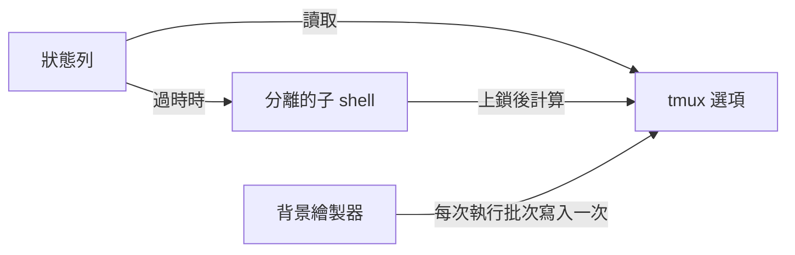

<div align="center">

# tmux-plugin-template

<strong>tmux-revamped 插件的起點：共用程式庫、bats 測試框架和 CI。</strong>

[English](README.md) &nbsp;|&nbsp; [日本語](README.ja.md) &nbsp;|&nbsp; [简体中文](README.zh-Hans.md) &nbsp;|&nbsp; 繁體中文（香港）

[](https://github.com/tmux-revamped/tmux-plugin-template/actions/workflows/ci.yml)
[](https://github.com/tmux-revamped/tmux-plugin-template/releases/latest)
[](https://scorecard.dev/viewer/?uri=github.com/tmux-revamped/tmux-plugin-template)
[](LICENSE)

<p align="center">
  <a href="#功能">功能</a> &nbsp;|&nbsp;
  <a href="#系統要求">系統要求</a> &nbsp;|&nbsp;
  <a href="#開始一個新插件">開始一個新插件</a> &nbsp;|&nbsp;
  <a href="#用法">用法</a> &nbsp;|&nbsp;
  <a href="#設定">設定</a> &nbsp;|&nbsp;
  <a href="#運作原理">運作原理</a>
</p>

</div>

**8** 個共用程式庫模組。**10** 個系列指令。**10** 個 CI 測試工作，涵蓋 Ubuntu 和 macOS、x86_64 和 arm64。

---

## 功能

本儲存庫不是用來安裝的插件。它是每個 `tmux-*-revamped` 插件的起點，本身亦是系列的成員，因此其共用檔案與其他所有成員保持一致。

| 部分 | 路徑 | 新插件得到甚麼 |
|:-----|:-----|:-----------------------|
| 共用程式庫 | [`lib`](lib) | 存放在 tmux 選項中的狀態快取、背景繪製器、批次寫入選項、tmux 選項輔助函數、平台偵測，以及可選開啟的錯誤日誌 |
| 測試框架 | [`test`](test) | bats 輔助函數，單元測試用記憶體中的 tmux 模擬，整合測試用獨立 socket 的 tmux 伺服器 |
| CI 和發佈 | [`.github/workflows`](.github/workflows) | `ci.yml` 執行 lint、在 Ubuntu 和 macOS 上使用 GNU、BSD 和 uutils 工具的測試、下限 95% 的 kcov 和安全掃描；`release.yml` 在推送通過 `ci` 後用 semantic-release 發佈；`bot-merge.yml` 合併通過檢查的 Dependabot 或 Renovate 拉取請求 |
| make 目標 | [`Makefile`](Makefile) | `fmt`、`lint`、`test`、`test-all`、`test-linux`、`coverage`、`check`、`clean` |

## 系統要求

| 工具 | 版本 | 用途 |
|:-----|:--------|:---------|
| tmux | 3.2 或以上 | 所有成員都支援的系列下限 |
| bash | 3.2 或以上 | 程式庫和測試可在 macOS 的 `/bin/bash` 上執行 |
| bats-core | 任何 | `make test` |
| shfmt、shellcheck、yamllint 和 actionlint | 任何 | `make lint` |
| Docker | 任何 | 在 Ubuntu 容器中執行的 `make test-linux` 和 `make coverage` |

## 開始一個新插件

1. 以新名稱複製範本，並令它指向新儲存庫：

   ```bash
   git clone https://github.com/tmux-revamped/tmux-plugin-template tmux-example-revamped
   cd tmux-example-revamped
   git remote set-url origin https://github.com/tmux-revamped/tmux-example-revamped.git
   ```

2. 在根目錄加入入口腳本 `example-revamped.tmux`。TPM 會執行插件目錄中的每個 `*.tmux` 檔案。把插件邏輯放在 `lib/example.sh`，自己的模組放在 `lib/` 下。[tmux-time-revamped](https://github.com/tmux-revamped/tmux-time-revamped) 就是以這種方式建立的完整狀態插件。
3. 把 [`lib/core.sh`](lib/core.sh) 中的 `TMUX_PLUGIN_TEMPLATE_VERSION` 重新命名為 `EXAMPLE_REVAMPED_VERSION`。發佈會寫入該常數，並把說明寫入 [`CHANGELOG.md`](CHANGELOG.md)。
4. 每個 tmux 選項都命名為 `@example_revamped_<name>`，並全部寫入 [`README.md`](README.md)。
5. 從 [`FAMILY.md`](FAMILY.md) 中 Key bindings 的分配裏最多選一個預設按鍵，其他動作預設不綁定。
6. 在同一個任務中，於每個成員裏把儲存庫加入 [`FAMILY.md`](FAMILY.md) 的成員表和 `cmp` 迴圈，以及每個 README 的家族部分。
7. 以與本檔案相同的頁首編寫 README，從另一個成員複製 `family:begin` 和 `family:end` 標記之間的部分，並標出本插件所在的行。
8. 執行「開發」一節中的檢查，直至全部以 0 結束。

[`FAMILY.md`](FAMILY.md) 列為相同的每個檔案在所有成員中保持一致。修改其中之一時，要在同一個任務中修改每個成員。

## 用法

狀態插件載入快取並從中繪製。狀態列即時得到保存的值，過時的值會在分離的子 shell 中重新計算：

```bash
#!/usr/bin/env bash

PLUGIN_DIR="$(cd "$(dirname "${BASH_SOURCE[0]}")/.." && pwd)"
export CACHE_PREFIX="example_revamped"
source "${PLUGIN_DIR}/lib/cache.sh"

read_load() { uptime; }

cache_render load 5 read_load
```

| 模組 | 函數 |
|:-------|:----------|
| [`lib/cache.sh`](lib/cache.sh) | `cache_render`、`cache_get`、`cache_set`、`cache_age`、`cache_is_fresh`、`cache_refresh_if_stale`、`cache_set_if_stale` |
| [`lib/ticker.sh`](lib/ticker.sh) | `ticker_start`、`ticker_run`、`ticker_interval`，用於每部伺服器一個背景繪製器 |
| [`lib/publish.sh`](lib/publish.sh) | 用於批次寫入選項的 `publish_add`、`publish_commit`，把每個 `#` 加倍的 `publish_escape`，用於固定寬度的 `publish_pad` 和 `publish_width` |
| [`lib/tmux.sh`](lib/tmux.sh) | `get_tmux_option`、`set_tmux_option`、`unset_tmux_option`，視窗和窗格選項輔助函數，窗格和視窗尺寸讀取 |
| [`lib/platform.sh`](lib/platform.sh) | `platform_os`、`platform_arch`、`is_macos`、`is_linux`、`is_bsd`、`is_apple_silicon`，每個進程只計算一次 |
| [`lib/command.sh`](lib/command.sh) | `has_command` |
| [`lib/log.sh`](lib/log.sh) | `log_error` |
| [`lib/core.sh`](lib/core.sh) | 版本常數和共用預設值 |

來自用戶設定以外的文字，例如進程名稱、網絡回應或檔案名稱，在到達狀態列之前都要經過 `publish_escape`，這樣它便無法作為 tmux 格式執行。

## 設定

範本不綁定按鍵，亦不讀取自己的選項。程式庫會在插件選擇的前綴下讀取以下選項：

| 選項 | 讀取方 | 意思 |
|:-------|:--------|:--------|
| `@<prefix>_<key>` | 快取 | 快取的值，並附有表示時效的 `_ts` 和更新進行中的 `_lock` |
| `@<prefix>_interval` | ticker | `minute`，或背景繪製間隔的秒數。其他值依次退回 `status-interval`，再退回 5 |
| `@<prefix>_ticker_pid` | ticker | 負責背景繪製的進程 |
| `@<prefix>_fixed_width` | publish | 設為 `on` 時把值補齊至自然寬度 |
| `@<prefix>_<metric>_width` | publish | 單一值的明確寬度 |
| `@<namespace>_enable_logging` | 錯誤日誌 | 設為 `1` 時寫入 `~/.tmux/<namespace>-logs/<namespace>.log`，超過 1 MB 後輪替 |

對快取而言，`<prefix>` 是 `CACHE_PREFIX`；對 ticker 和 publish 函數而言，是傳入的參數。`<namespace>` 是把 `PLUGIN_LOG_NS` 中的 `-` 換成 `_` 的結果。

## 運作原理



`cache_render` 傳回保存的選項值。當該值比給定時長更舊時，它設定一個鎖選項，並在分離的子 shell 中開始更新，因此繪製永遠不會等待指令。超過 20 秒的鎖視為失效，因此崩潰的更新不會阻塞下一次更新。所有狀態都在 tmux 伺服器選項中，因此不會寫入磁碟，伺服器停止後便消失。

對於佔位符執行頻繁的插件，`ticker_run` 為每部伺服器保留一個背景進程。它佔用 `@<prefix>_ticker_pid`，每次執行時以一次 tmux 呼叫讀取所需的全部選項，繪製後再以一次呼叫寫入所有值和重繪，並在另一個進程佔用該選項或伺服器停止時結束。

## 開發

| 指令 | 執行內容 |
|:--------|:-------------|
| `make fmt` | 對每個腳本執行 `shfmt -i 2` |
| `make lint` | shfmt、shellcheck、yamllint 和 actionlint，零問題 |
| `make test` | bats 測試套件 |
| `make test-all` | 依次以每個已安裝的 bash 和 zsh 作為登入 shell 執行 bats 測試套件 |
| `make test-linux` | 在 Ubuntu 容器中執行 bats 測試套件 |
| `make coverage` | 在 Ubuntu 容器中量度 kcov 行覆蓋率，下限 95% |

當本 README 中的相對連結指向不存在的路徑時，[`test/docs.bats`](test/docs.bats) 會失敗。

提交遵循約定式提交格式，直接進入 `main`。`main` 上的 `ci` 通過後，`release.yml` 執行 semantic-release：上一個標籤以來的每個 `feat` 或 `fix` 都會發佈一個版本、寫入版本常數，並把說明加入 [`CHANGELOG.md`](CHANGELOG.md)。

## 授權

[MIT](LICENSE)，copyright Gustavo Franco。

<!-- family:begin -->

## tmux-revamped 插件家族

這個插件是 tmux-revamped 插件家族的一員。每個成員都帶有 [`FAMILY.md`](FAMILY.md) 中相同的約定和相同的共用程式庫，並且設計為一起安裝：沒有成員佔用另一個成員佔用的按鍵或 tmux 選項。

在一個成員中發現的缺陷，要在全部成員中排查後才算修正完成。

| 成員 | 功能 |
|---|---|
| [`tmux-autoreload-revamped`](https://github.com/tmux-revamped/tmux-autoreload-revamped) | 編輯並儲存 tmux 設定後，它會自動重新載入，毋須按鍵，也毋須指令 |
| [`tmux-battery-revamped`](https://github.com/tmux-revamped/tmux-battery-revamped) | 在 tmux 狀態列顯示電池狀態，從不阻塞狀態列繪製 |
| [`tmux-bluetooth-revamped`](https://github.com/tmux-revamped/tmux-bluetooth-revamped) | 在 tmux 狀態列顯示每部已連接的藍牙裝置及其電量，不阻塞繪製 |
| [`tmux-cpu-revamped`](https://github.com/tmux-revamped/tmux-cpu-revamped) | 在 tmux 狀態列顯示 CPU 負載、溫度及頻率，從不阻塞繪製 |
| [`tmux-disk-revamped`](https://github.com/tmux-revamped/tmux-disk-revamped) | 在 tmux 狀態列顯示磁碟用量，從不阻塞狀態列繪製 |
| [`tmux-extract-revamped`](https://github.com/tmux-revamped/tmux-extract-revamped) | 用 fzf 從畫面上揀選 URL、路徑、雜湊值或任何其他字詞，並輸入到游標位置，全部以純 shell 實現 |
| [`tmux-fzf-revamped`](https://github.com/tmux-revamped/tmux-fzf-revamped) | 在彈出視窗的 fzf 選擇器中切換、關閉、重新命名或建立 tmux 工作階段、視窗和窗格 |
| [`tmux-git-revamped`](https://github.com/tmux-revamped/tmux-git-revamped) | 在 tmux 狀態列顯示當前窗格的 git 分支、改動和託管平台數目，而不會阻塞顯示 |
| [`tmux-gpu-revamped`](https://github.com/tmux-revamped/tmux-gpu-revamped) | 在 tmux 狀態列顯示 NVIDIA、AMD、Intel 及 Apple GPU 的負載、溫度、時脈、功耗及記憶體 |
| [`tmux-kube-revamped`](https://github.com/tmux-revamped/tmux-kube-revamped) | 在 tmux 狀態列顯示目前的 Kubernetes 上下文及命名空間，毋須 kubectl，直接解析 kubeconfig |
| [`tmux-launcher-revamped`](https://github.com/tmux-revamped/tmux-launcher-revamped) | 在彈出視窗或新視窗中啟動任何 TUI 應用程式，從目前窗格的目錄開始，每個應用程式可設定一個按鍵 |
| [`tmux-logging-revamped`](https://github.com/tmux-revamped/tmux-logging-revamped) | 將任何窗格儲存到檔案：即時記錄、完整捲動緩衝區或一次性截圖 |
| [`tmux-music-revamped`](https://github.com/tmux-revamped/tmux-music-revamped) | 在 tmux 狀態列顯示正在播放的歌曲，從不阻塞狀態列的繪製 |
| [`tmux-network-revamped`](https://github.com/tmux-revamped/tmux-network-revamped) | 在 tmux 狀態列顯示網絡傳輸量，從不阻塞繪製 |
| [`tmux-pain-control-revamped`](https://github.com/tmux-revamped/tmux-pain-control-revamped) | tmux 的窗格和視窗管理按鍵，配合 tmux 版本，與 vim 相容，每個 prefix 按鍵都可停用 |
| [`tmux-persist-revamped`](https://github.com/tmux-revamped/tmux-persist-revamped) | 儲存 tmux 的所有工作階段、視窗及窗格，按計時器自動儲存，並在重新開機後全部還原 |
| [`tmux-plugin-template`](https://github.com/tmux-revamped/tmux-plugin-template) | **本插件**，tmux-revamped 插件的起點：共用程式庫、bats 測試框架和 CI |
| [`tmux-pomodoro-revamped`](https://github.com/tmux-revamped/tmux-pomodoro-revamped) | tmux 狀態列中的番茄鐘計時器，所有狀態都儲存在 tmux 選項中，不使用暫存檔 |
| [`tmux-ram-revamped`](https://github.com/tmux-revamped/tmux-ram-revamped) | 在 tmux 狀態列顯示記憶體、交換空間及記憶體壓力，在背景取樣，繪製從不等待 |
| [`tmux-reorder-revamped`](https://github.com/tmux-revamped/tmux-reorder-revamped) | 用滑鼠在 tmux 狀態列上拖動視窗標籤來移動該視窗 |
| [`tmux-scroll-revamped`](https://github.com/tmux-revamped/tmux-scroll-revamped) | 將滑鼠滾輪交給能自行捲動的應用程式，其他情況下進入 tmux 複製模式 |
| [`tmux-sensible-revamped`](https://github.com/tmux-revamped/tmux-sensible-revamped) | 按 tmux 版本和終端機區分的合理預設設定，不會改動你自己設定的選項 |
| [`tmux-tiling-revamped`](https://github.com/tmux-revamped/tmux-tiling-revamped) | tmux 的平鋪視窗管理：八種版面，包括 BSP dwindle 和 spiral，並支援復原版面 |
| [`tmux-time-revamped`](https://github.com/tmux-revamped/tmux-time-revamped) | 狀態列中的本地時鐘和世界時鐘，按一天中的時段著色，並提供倒數和夏令時間提示 |
| [`tmux-weather-revamped`](https://github.com/tmux-revamped/tmux-weather-revamped) | 在背景從 wttr.in 取得天氣並顯示在狀態列，狀態列毋須等待 |

<!-- family:end -->
