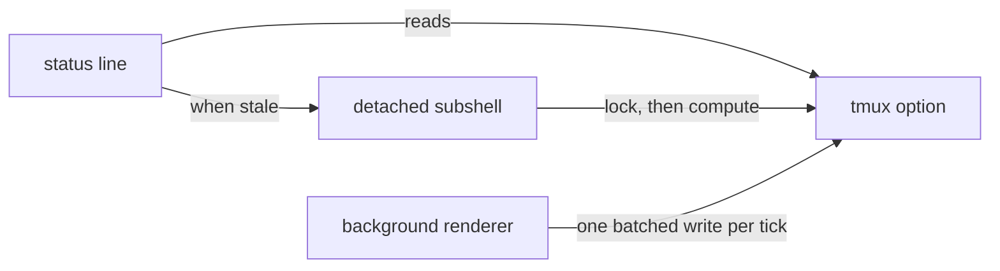
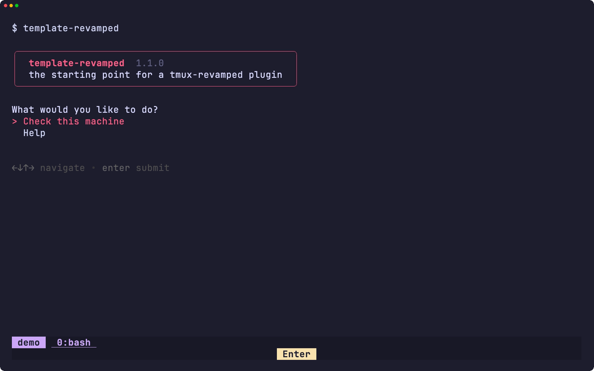
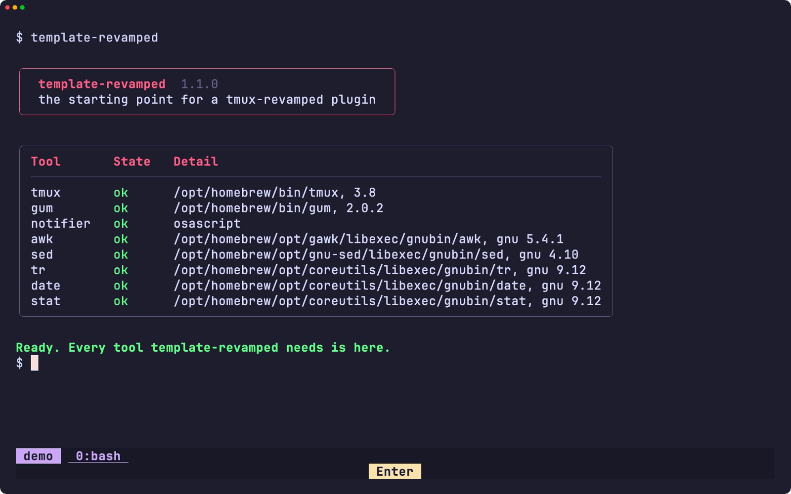
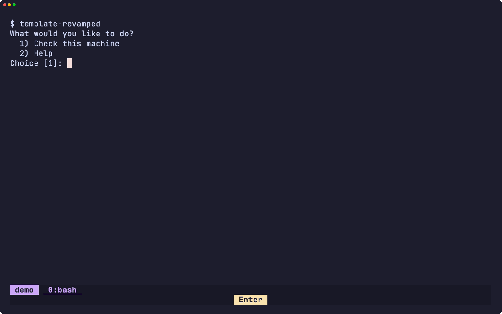
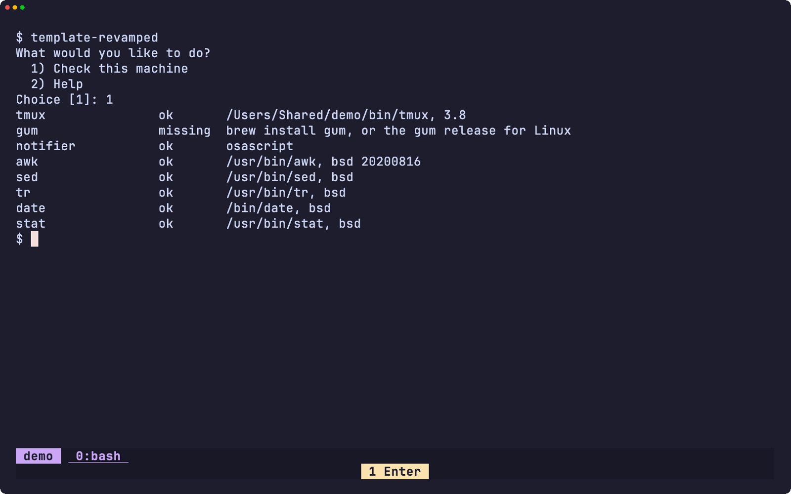
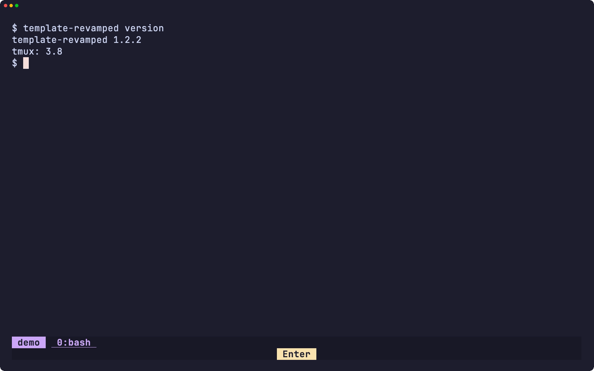
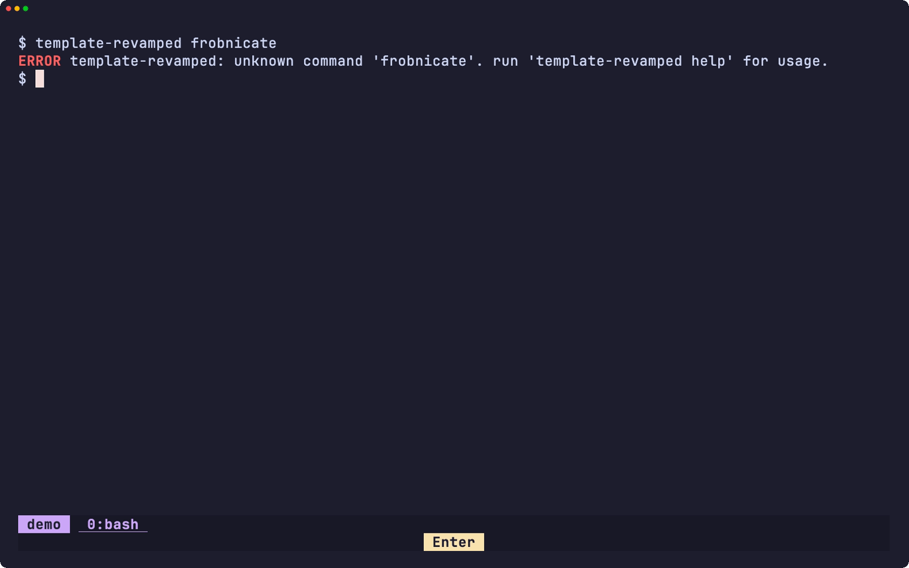
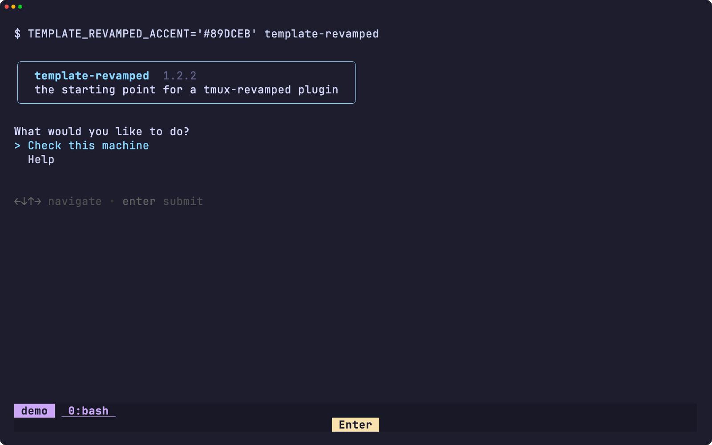
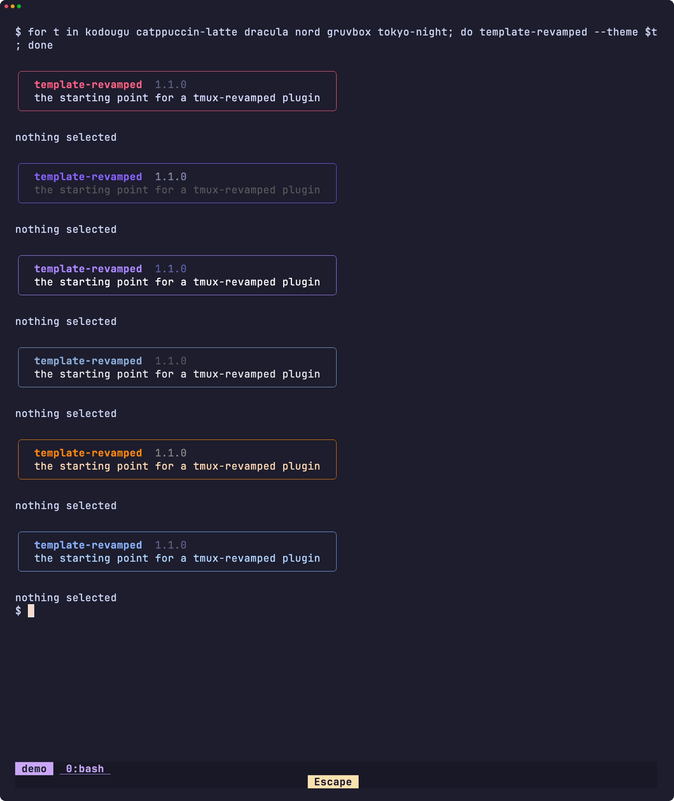
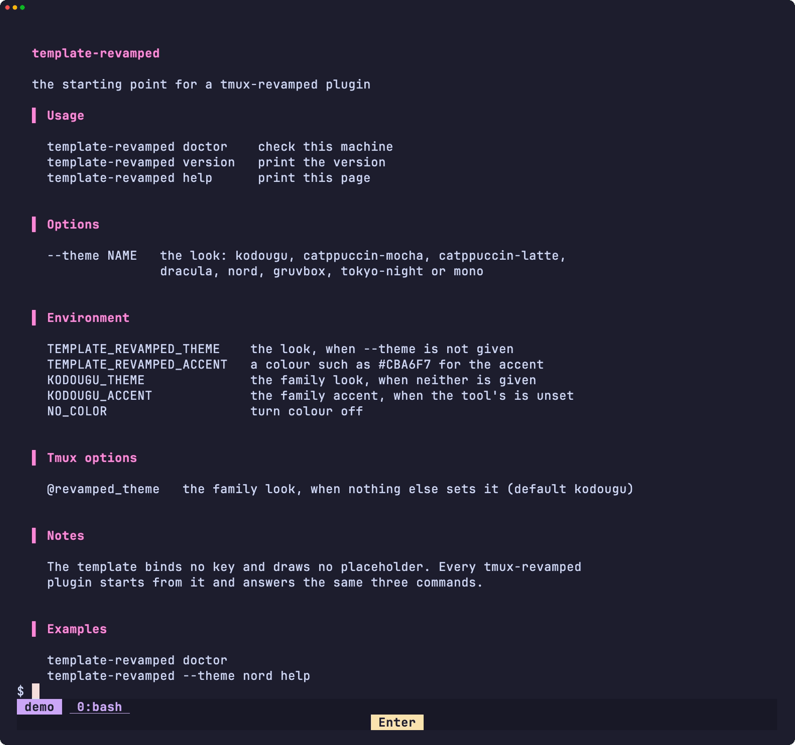

<div align="center">

# tmux-plugin-template

<strong>tmux-revamped 插件的起点：共享库、bats 测试框架和 CI。</strong>

[English](README.md) &nbsp;|&nbsp; [日本語](README.ja.md) &nbsp;|&nbsp; 简体中文 &nbsp;|&nbsp; [繁體中文（香港）](README.zh-HK.md)

[](https://github.com/tmux-revamped/tmux-plugin-template/actions/workflows/ci.yml)
[](https://github.com/tmux-revamped/tmux-plugin-template/releases/latest)
[](https://scorecard.dev/viewer/?uri=github.com/tmux-revamped/tmux-plugin-template)
[](LICENSE)

<p align="center">
  <a href="#快速开始"><strong>快速开始</strong></a> &nbsp;|&nbsp;
  <a href="#用法">用法</a> &nbsp;|&nbsp;
  <a href="#开始一个新插件">开始一个新插件</a> &nbsp;|&nbsp;
  <a href="#共享库">共享库</a> &nbsp;|&nbsp;
  <a href="#界面">界面</a>
</p>

</div>

<p align="center">
  
</p>

```console
$ template-revamped doctor | cat
tmux               ok       /opt/homebrew/bin/tmux, 3.8
gum                ok       /opt/homebrew/bin/gum, 2.0.2
notifier           ok       osascript
awk                ok       /usr/bin/awk, bsd 20200816
sed                ok       /usr/bin/sed, bsd
tr                 ok       /usr/bin/tr, bsd
date               ok       /bin/date, bsd
stat               ok       /usr/bin/stat, bsd
```

这个仓库不是装进 tmux 使用的插件。它是每个 `tmux-*-revamped` 插件的起点，本身也是家族的一员，所以它的共享文件与其他所有成员保持完全一致。它附带 `template-revamped` 命令，每个成员都用自己的名字提供同样的命令：`doctor`、`version`、`help` 和一个菜单。

---

## 快速开始

### 前提条件

| 工具 | 版本 | 用途 |
|:-----|:--------|:---------|
| tmux | 3.2 或更高 | 家族所有成员都支持的最低版本 |
| POSIX shell | 任意 | `sh`、`dash`、`bash` 3.2 及更高版本、`zsh` |
| gum | 可选 | 菜单、表格和颜色；没有它时每个命令都输出纯文本 |
| git 和 make | 任意 | 克隆和安装 |

### 安装

```bash
git clone https://github.com/tmux-revamped/tmux-plugin-template
cd tmux-plugin-template
make install
```

`make install` 把 `template-revamped` 放进 `~/.local/bin`，把它的 man 手册以及 bash、zsh、fish 补全放在 `~/.local/share` 下。要装到别处，就设置 `PREFIX`，例如 `make install PREFIX=/usr/local`。

### 验证

```bash
template-revamped doctor
```

`doctor` 为每个工具打印一行，给出路径；对核心工具，还给出它的类型和版本。只有缺少必需的工具时，它才以 1 退出。

## 用法

| 命令 | 作用 |
|:--------|:-------------|
| `template-revamped` | 在终端中显示菜单：检查这台机器，或者查看帮助 |
| `template-revamped doctor` | 每个依赖一行：tmux、gum、桌面通知和核心工具 |
| `template-revamped version` | 版本号，然后是 tmux 的版本 |
| `template-revamped help` | 帮助页面。`man template-revamped` 说明同样的命令、选项和设置 |

| 选项 | 含义 |
|:-------|:--------|
| `--theme NAME` | `kodougu`、`catppuccin-mocha`、`catppuccin-latte`、`dracula`、`nord`、`gruvbox`、`tokyo-night` 或 `mono`。默认是 `kodougu` |

| 环境变量 | 含义 |
|:------------|:--------|
| `TEMPLATE_REVAMPED_THEME` | 没有给出 `--theme` 时使用的主题 |
| `TEMPLATE_REVAMPED_ACCENT` | 替换主题强调色的颜色，例如 `#CBA6F7` |
| `KODOUGU_THEME` | 上面两项都没有设置时，所有 kodougu 和 tmux-revamped 工具共用的主题 |
| `KODOUGU_ACCENT` | 没有设置 `TEMPLATE_REVAMPED_ACCENT` 时，所有 kodougu 和 tmux-revamped 工具共用的强调色 |
| `NO_COLOR` | 在任何主题下关闭颜色 |

| tmux 选项 | 含义 |
|:------------|:--------|
| `@revamped_theme` | 没有其他设置时，所有 tmux-revamped 工具共用的主题。默认是 `kodougu` |

模板不绑定任何按键，也不绘制任何占位符。

## 开始一个新插件

```bash
make new-member NAME=clipboard
```

这会创建 `../tmux-clipboard-revamped`，一个所有文件都已暂存的新 git 仓库：

- `bin/clipboard-revamped` 及其 man 手册和补全，所有名称和前缀都已替换：`CLIPBOARD_REVAMPED_THEME`、`clipboard_revamped_help`，以及值为 `0.0.0` 的 `CLIPBOARD_REVAMPED_VERSION`。
- 共享库、测试、CI、发布工作流和界面录制脚本。[`FAMILY.md`](FAMILY.md) 列为完全一致的文件，一个字节都不改。
- 一份带有家族统一标题的代理指南，以及一份只有标题和家族章节的 README。指南的 Gaps 章节列出剩下的工作：README、插件的入口文件和录屏。

`DEST` 用来指定别的目录，例如 `make new-member NAME=clipboard DEST=/path/to/tmux-clipboard-revamped`。然后：

1. 在根目录添加入口文件 `clipboard-revamped.tmux`；TPM 会运行插件目录中的每个 `*.tmux` 文件。把插件的逻辑放进 `lib/clipboard.sh`。[tmux-time-revamped](https://github.com/tmux-revamped/tmux-time-revamped) 就是按这种方式构建的完整状态栏插件。
2. 每个 tmux 选项都命名为 `@clipboard_revamped_<name>`，并在同一个提交里写进帮助页面、man 手册、补全和 README。
3. 默认按键最多从 [`FAMILY.md`](FAMILY.md) 中 Key bindings 的分配里选一个，其他操作一律不绑定。
4. 用 `make screens` 录下每个功能，并用字幕标出录制脚本按下的每个键。
5. 在同一项工作中，把仓库加入每个成员的 [`FAMILY.md`](FAMILY.md) 成员表和 `cmp` 循环，以及每份 README 的家族章节。
6. 运行开发章节中的检查，直到全部以 0 退出。

## 共享库

状态栏插件加载缓存并从中渲染。状态栏立即拿到已保存的值，过期的值在分离的子 shell 中重新计算：

```sh
#!/bin/sh

REVAMPED_LIB="$(cd "$(dirname "$0")/../lib" && pwd)"
REVAMPED_CACHE_PREFIX=clipboard_revamped
. "${REVAMPED_LIB}/cache.sh"

read_load() { uptime; }

revamped_cache_render load 5 read_load
```

| 模块 | 插件得到什么 |
|:-------|:-----------------------|
| [`lib/cache.sh`](lib/cache.sh) | `revamped_cache_render`、`revamped_cache_get`、`revamped_cache_set`、`revamped_cache_age`、`revamped_cache_is_fresh`、`revamped_cache_refresh_if_stale` 和 `revamped_cache_set_if_stale`，所有值都保存在 tmux 选项中 |
| [`lib/ticker.sh`](lib/ticker.sh) | `revamped_ticker_start`、`revamped_ticker_run` 和 `revamped_ticker_interval`，每个服务器一个后台渲染进程 |
| [`lib/publish.sh`](lib/publish.sh) | 批量写选项的 `revamped_publish_add` 和 `revamped_publish_commit`，把每个 `#` 加倍的 `revamped_publish_escape`，以及用于固定宽度的 `revamped_publish_pad` 和 `revamped_publish_width` |
| [`lib/tmux.sh`](lib/tmux.sh) | `revamped_tmux_get`、`revamped_tmux_set`、`revamped_tmux_unset`，窗口和窗格选项的辅助函数，以及窗格和窗口的尺寸 |
| [`lib/platform.sh`](lib/platform.sh) | `revamped_platform_os`、`revamped_platform_arch`、`revamped_is_macos`、`revamped_is_linux`、`revamped_is_bsd` 和 `revamped_is_apple_silicon`，每个进程只计算一次 |
| [`lib/notify.sh`](lib/notify.sh) | `revamped_notify_if_enabled`：插件的选项为 `1` 时，通过 `osascript` 或 `notify-send` 发出桌面通知 |
| [`lib/command.sh`](lib/command.sh) | `revamped_has_command` |
| [`lib/log.sh`](lib/log.sh) | `revamped_log_error`，可选开启的错误日志 |
| [`lib/ui.sh`](lib/ui.sh) 和 [`lib/table.awk`](lib/table.awk) | 终端界面：标题、输入、表格、日志、加载动画和帮助页面，能用 gum 的地方用 gum 绘制，其他地方输出纯文本 |
| [`lib/cli.sh`](lib/cli.sh) | 成员命令的主题选择、菜单、用法错误和帮助页面 |
| [`lib/doctor.sh`](lib/doctor.sh) | `doctor` 的各行：每个工具的路径、类型和版本 |
| [`lib/core.sh`](lib/core.sh) | 版本常量 |

凡是来自用户配置之外的文本，例如进程名、网络响应或文件名，都要先经过 `revamped_publish_escape` 再进入状态栏，这样它就不会被当作 tmux 格式执行。

库会读取插件所选前缀下的这些选项：

| 选项 | 读取者 | 含义 |
|:-------|:--------|:--------|
| `@<prefix>_<key>` | cache | 缓存的值，`_ts` 记录它的时间，刷新进行中时有 `_lock` |
| `@<prefix>_interval` | ticker | `minute`，或后台渲染之间的秒数。其他值依次退回到 `status-interval` 和 5 |
| `@<prefix>_ticker_pid` | ticker | 持有后台渲染的进程 |
| `@<prefix>_fixed_width` | publish | `on` 把值填充到它的自然宽度 |
| `@<prefix>_<metric>_width` | publish | 为单个值显式指定宽度 |
| `@<namespace>_enable_logging` | 错误日志 | `1` 写入 `~/.tmux/<namespace>-logs/<namespace>.log`，超过 1 MB 时轮换 |

对缓存来说，`<prefix>` 是 `REVAMPED_CACHE_PREFIX`；对 ticker 和 publish 函数来说，是传入的参数。`<namespace>` 是把 `REVAMPED_LOG_NS` 中的 `-` 换成 `_` 的结果。



`revamped_cache_render` 返回已保存的选项值。当值比给定的时间更旧时，它设置一个锁选项，并在分离的子 shell 中开始刷新，所以渲染从不等待命令。超过 20 秒的锁视为失效，崩溃的刷新不会挡住下一次。所有状态都在 tmux 服务器选项中，不向磁盘写任何东西，服务器停止后就消失。

对于占位符刷新频繁的插件，`revamped_ticker_run` 为每个服务器保留一个后台进程。它占用 `@<prefix>_ticker_pid`，每一轮用一次 tmux 调用读取所需的全部选项，渲染后再用一次调用写入所有值并重绘；当另一个进程占用该选项或服务器停止时退出。

<a id="界面"></a>

## 界面

<details>
<summary>每个界面都用 <code>make screens</code> 在真实的 tmux 中录制，按下的每个键都显示在状态栏上</summary>
<br>

<table>
<tr>
<td width="50%" valign="top"><br><sub>菜单，来自 <code>hero.tape</code></sub></td>
<td width="50%" valign="top"><br><sub>doctor 检查每个工具，来自 <code>hero.tape</code></sub></td>
</tr>
<tr>
<td width="50%" valign="top"><br><sub>没有 gum 时的菜单，来自 <code>stills.tape</code></sub></td>
<td width="50%" valign="top"><br><sub>没有 gum 时的 doctor，使用 macOS 自带的工具，来自 <code>stills.tape</code></sub></td>
</tr>
<tr>
<td width="50%" valign="top"><br><sub>版本，来自 <code>stills.tape</code></sub></td>
<td width="50%" valign="top"><br><sub>未知命令，来自 <code>stills.tape</code></sub></td>
</tr>
<tr>
<td width="50%" valign="top"><br><sub>来自 <code>TEMPLATE_REVAMPED_ACCENT</code> 的强调色，来自 <code>stills.tape</code></sub></td>
<td width="50%" valign="top"><br><sub>六个主题下的标题，来自 <code>themes.tape</code></sub></td>
</tr>
<tr>
<td width="50%" valign="top"><br><sub>帮助页面，来自 <code>help.tape</code></sub></td>
<td width="50%" valign="top"></td>
</tr>
</table>

</details>

## 可移植性

库和工具都是 POSIX `sh`。CI 在下面每一行上运行全部测试。

| Shell | 状态 |
|:------|:-------|
| `dash`、macOS 上的 `/bin/sh` | 支持 |
| `bash` 3.2 和 5.x、系统自带的 `zsh` 和 Homebrew 的 `zsh` | 支持 |

| 系统 | 状态 |
|:-------|:-------|
| macOS | Apple Silicon 和 Intel 上的 Tahoe，使用系统自带的工具、Homebrew 的 GNU 工具和 Homebrew 的 uutils |
| Linux | x86_64 和 arm64 上的 Ubuntu 26.04，使用 GNU coreutils、uutils 和 BusyBox |
| FreeBSD、OpenBSD、NetBSD | 不在 CI 覆盖范围内 |

`template-revamped doctor` 会给出每个核心工具的类型和版本，例如 `gnu 9.12`、`uutils 0.12.0` 或 `bsd 20200816`，所以从问题报告里就能看出用的是哪套工具。

## 开发

| 命令 | 运行内容 |
|:--------|:-------------|
| `make fmt` | 对每个脚本运行 shfmt `-i 2` |
| `make lint` | shfmt、ShellCheck、mandoc、yamllint 和 actionlint，零告警 |
| `make test` | 在系统 `sh` 下运行 bats 测试 |
| `make test-all` | 在每个已安装的 shell 下运行测试，macOS 上包括 bash 和 zsh 的两种构建 |
| `make test-linux` | 在 Ubuntu 容器中运行测试 |
| `make coverage` | 在这台 Mac 和 Ubuntu 容器中运行 bashcov，合并后以 100% 为门槛 |
| `make screens` | 用 VHS 在 tmux 中从真实工具录制上面的界面，在 macOS 上运行 |
| `make install` | 把工具、man 手册和补全安装到 `PREFIX` 下 |
| `make new-member NAME=<name>` | 新成员，见「开始一个新插件」 |

在 macOS 上，运行 `brew bundle` 会根据 [`Brewfile`](Brewfile) 安装这些目标用到的所有工具。

当这份 README 中的相对链接指向不存在的路径时，[`test/docs.bats`](test/docs.bats) 会失败。

提交遵循 Conventional Commits 格式，直接进入 `main`。`main` 上的 `ci` 通过后，`release.yml` 运行 semantic-release：自上一个标签以来的每个 `feat` 或 `fix` 都会发布新版本，更新版本常量，并把说明写进 [`CHANGELOG.md`](CHANGELOG.md)。

## 许可证

[MIT](LICENSE)，copyright Gustavo Franco。

<!-- family:begin -->

## tmux-revamped 插件家族

这个插件是 tmux-revamped 插件家族的一员。每个成员都带有 [`FAMILY.md`](FAMILY.md) 中相同的约定和相同的共享库，并且设计为一起安装：没有成员占用另一个成员占用的按键或 tmux 选项。

在一个成员中发现的缺陷，要在全部成员中排查之后才算修复完成。

| 成员 | 功能 |
|---|---|
| [`tmux-autoreload-revamped`](https://github.com/tmux-revamped/tmux-autoreload-revamped) | 编辑并保存 tmux 配置后，它会自动重新加载，无需按键，也无需命令 |
| [`tmux-battery-revamped`](https://github.com/tmux-revamped/tmux-battery-revamped) | 在 tmux 状态栏显示电池状态，从不阻塞状态栏渲染 |
| [`tmux-bluetooth-revamped`](https://github.com/tmux-revamped/tmux-bluetooth-revamped) | 在 tmux 状态栏显示每个已连接的蓝牙设备及其电量，不阻塞渲染 |
| [`tmux-cpu-revamped`](https://github.com/tmux-revamped/tmux-cpu-revamped) | 在 tmux 状态栏显示 CPU 负载、温度和频率，从不阻塞渲染 |
| [`tmux-disk-revamped`](https://github.com/tmux-revamped/tmux-disk-revamped) | 在 tmux 状态栏显示磁盘用量，从不阻塞状态栏渲染 |
| [`tmux-extract-revamped`](https://github.com/tmux-revamped/tmux-extract-revamped) | 用 fzf 从屏幕上挑选 URL、路径、哈希或任意其他词元，并输入到光标处，全部用纯 shell 实现 |
| [`tmux-fzf-revamped`](https://github.com/tmux-revamped/tmux-fzf-revamped) | 在弹出窗口中的 fzf 选择器里切换、关闭、重命名或创建 tmux 会话、窗口和窗格 |
| [`tmux-git-revamped`](https://github.com/tmux-revamped/tmux-git-revamped) | 在 tmux 状态栏中显示活动窗格的 git 分支、改动和托管平台计数，且不阻塞渲染 |
| [`tmux-gpu-revamped`](https://github.com/tmux-revamped/tmux-gpu-revamped) | 在 tmux 状态栏中显示 NVIDIA、AMD、Intel 和 Apple GPU 的负载、温度、频率、功耗和显存 |
| [`tmux-kube-revamped`](https://github.com/tmux-revamped/tmux-kube-revamped) | 在 tmux 状态栏中显示当前的 Kubernetes 上下文和命名空间，不依赖 kubectl，直接解析 kubeconfig |
| [`tmux-launcher-revamped`](https://github.com/tmux-revamped/tmux-launcher-revamped) | 在弹出窗口或新窗口中启动任意 TUI 应用，从当前窗格的目录开始，每个应用可配置一个按键 |
| [`tmux-logging-revamped`](https://github.com/tmux-revamped/tmux-logging-revamped) | 将任意窗格保存到文件：实时日志、完整回滚缓冲区或一次性截图 |
| [`tmux-music-revamped`](https://github.com/tmux-revamped/tmux-music-revamped) | 在 tmux 状态栏显示正在播放的曲目，从不阻塞状态栏渲染 |
| [`tmux-network-revamped`](https://github.com/tmux-revamped/tmux-network-revamped) | 在 tmux 状态栏显示网络吞吐量，从不阻塞渲染 |
| [`tmux-pain-control-revamped`](https://github.com/tmux-revamped/tmux-pain-control-revamped) | tmux 的窗格和窗口管理按键，适配 tmux 版本，兼容 vim，每个 prefix 按键都可禁用 |
| [`tmux-persist-revamped`](https://github.com/tmux-revamped/tmux-persist-revamped) | 保存 tmux 的所有会话、窗口和窗格，按定时器自动保存，并在重启后全部恢复 |
| [`tmux-plugin-template`](https://github.com/tmux-revamped/tmux-plugin-template) | **本插件**，tmux-revamped 插件的起点：共享库、bats 测试框架和 CI |
| [`tmux-pomodoro-revamped`](https://github.com/tmux-revamped/tmux-pomodoro-revamped) | tmux 状态栏中的番茄钟计时器，所有状态都保存在 tmux 选项中，不使用临时文件 |
| [`tmux-ram-revamped`](https://github.com/tmux-revamped/tmux-ram-revamped) | 在 tmux 状态栏显示内存、交换空间和内存压力，在后台采样，渲染从不等待 |
| [`tmux-reorder-revamped`](https://github.com/tmux-revamped/tmux-reorder-revamped) | 用鼠标在 tmux 状态栏上拖动窗口标签来移动该窗口 |
| [`tmux-scroll-revamped`](https://github.com/tmux-revamped/tmux-scroll-revamped) | 将鼠标滚轮交给能自行滚动的应用，其他情况下进入 tmux 复制模式 |
| [`tmux-sensible-revamped`](https://github.com/tmux-revamped/tmux-sensible-revamped) | 按 tmux 版本和终端区分的合理默认设置，不改动你自己设置的选项 |
| [`tmux-tiling-revamped`](https://github.com/tmux-revamped/tmux-tiling-revamped) | tmux 的平铺窗口管理：八种布局，包括 BSP dwindle 和 spiral，并支持撤销布局 |
| [`tmux-time-revamped`](https://github.com/tmux-revamped/tmux-time-revamped) | 状态栏中的本地时钟和世界时钟，按一天中的时段着色，并提供倒计时和夏令时提醒 |
| [`tmux-weather-revamped`](https://github.com/tmux-revamped/tmux-weather-revamped) | 在后台从 wttr.in 获取天气并显示在状态栏，状态栏无需等待 |

<!-- family:end -->
