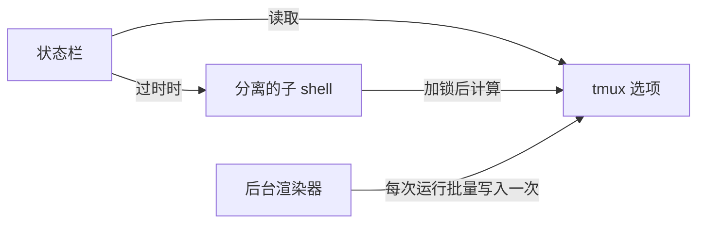

<div align="center">

# tmux-plugin-template

<strong>tmux-revamped 插件的起点：共享库、bats 测试框架、CI 和系列工具。</strong>

[English](README.md) &nbsp;|&nbsp; [日本語](README.ja.md) &nbsp;|&nbsp; 简体中文 &nbsp;|&nbsp; [繁體中文（香港）](README.zh-HK.md)

[](https://github.com/tmux-revamped/tmux-plugin-template/actions/workflows/tests.yml)
[](LICENSE)
[](CHANGELOG.md)

<p align="center">
  <a href="#功能">功能</a> &nbsp;|&nbsp;
  <a href="#环境要求">环境要求</a> &nbsp;|&nbsp;
  <a href="#开始一个新插件">开始一个新插件</a> &nbsp;|&nbsp;
  <a href="#用法">用法</a> &nbsp;|&nbsp;
  <a href="#配置">配置</a> &nbsp;|&nbsp;
  <a href="#工作原理">工作原理</a>
</p>

</div>

**8** 个共享库模块。**10** 个系列命令。**10** 个 CI 测试任务，覆盖 Ubuntu 和 macOS、x86_64 和 arm64。

---

## 功能

本仓库不是用来安装的插件。它是每个 `tmux-*-revamped` 插件的起点，本身也是系列的成员，因此其共享文件与其他所有成员保持一致。

| 部分 | 路径 | 新插件得到什么 |
|:-----|:-----|:-----------------------|
| 共享库 | [`src/lib`](src/lib) | 保存在 tmux 选项中的状态缓存、后台渲染器、批量写入选项、tmux 选项辅助函数、平台检测，以及可选开启的错误日志 |
| 测试框架 | [`test`](test) | bats 辅助函数，单元测试用内存中的 tmux 模拟，集成测试用独立套接字的 tmux 服务器 |
| CI | [`.github/workflows`](.github/workflows) | 在 Ubuntu 和 macOS 上使用 GNU、BSD 和 uutils 工具测试，shellcheck、actionlint、下限 95% 的 kcov、版本检查、每个新版本一次发布，以及每周的系列检查 |
| 系列工具 | [`family/bin`](family/bin) | 为 [`FAMILY.md`](FAMILY.md) 中的系列约定提供审计、同步、传播、排查、诊断和 README 生成 |
| make 目标 | [`Makefile`](Makefile) | `test`、`test-unit`、`coverage`、`lint`、`clean` |

## 环境要求

| 工具 | 版本 | 用途 |
|:-----|:--------|:---------|
| tmux | 3.2 或更高 | 所有成员都支持的系列下限 |
| bash | 3.2 或更高 | 库和测试可在 macOS 的 `/bin/bash` 上运行 |
| bats-core | 任意 | `make test` |
| shellcheck | 任意 | `make lint` |
| kcov 和 python3 | 任意 | `make coverage`，仅 Linux |

## 开始一个新插件

1. 以新名称复制模板，并让它指向新仓库：

   ```bash
   git clone https://github.com/tmux-revamped/tmux-plugin-template tmux-example-revamped
   cd tmux-example-revamped
   git remote set-url origin https://github.com/tmux-revamped/tmux-example-revamped.git
   ```

2. 在根目录添加入口脚本 `example-revamped.tmux`。TPM 会运行插件目录中的每个 `*.tmux` 文件。把插件逻辑放在 `src/example.sh`，自己的模块放在 `src/lib/example/` 下。[tmux-time-revamped](https://github.com/tmux-revamped/tmux-time-revamped) 就是以这种方式构建的完整状态插件。
3. 把 [`src/lib/utils/constants.sh`](src/lib/utils/constants.sh) 中的 `TMUX_PLUGIN_TEMPLATE_VERSION` 重命名为 `EXAMPLE_REVAMPED_VERSION`。如果该常量、[`CHANGELOG.md`](CHANGELOG.md) 的第一个带版本的标题和 README 中的 `version-X.Y.Z` 徽章不一致，CI 的 `version` 任务会失败。
4. 每个 tmux 选项都命名为 `@example_revamped_<name>`。CI 的 lint 任务从目录名取得标识，当 [`src/`](src) 下的某个选项没有出现在 [`README.md`](README.md) 中时失败。
5. 从 [`family/KEYS.md`](family/KEYS.md) 的分配中最多选一个默认按键，其他动作默认不绑定。
6. 把仓库加入 [`family/MEMBERS`](family/MEMBERS)。这两个文件都是共享的，所以在一个成员中修改后运行 `family/bin/propagate --message 'chore(family): add tmux-example-revamped'`，它会把文件复制到每个成员并创建拉取请求。
7. 使用与本文件相同的页眉编写 README，并保留 `family:begin` 和 `family:end` 标记。[`family/bin/gen-readme`](family/bin/gen-readme) 会根据 [`family/MEMBERS`](family/MEMBERS) 中的成员列表和每个成员的简介填充两者之间的部分。
8. 运行开发一节中的检查，直到全部以 0 退出。

[`family/OWNERSHIP`](family/OWNERSHIP) 中列为 `owned` 的每个文件在所有成员之间逐字节一致。只能通过 [`family/bin/propagate`](family/bin/propagate) 修改这些文件。

## 用法

状态插件加载缓存并从中渲染。状态栏立即得到保存的值，过时的值会在分离的子 shell 中重新计算：

```bash
#!/usr/bin/env bash

PLUGIN_DIR="$(cd "$(dirname "${BASH_SOURCE[0]}")/.." && pwd)"
export CACHE_PREFIX="example_revamped"
source "${PLUGIN_DIR}/src/lib/utils/cache.sh"

read_load() { uptime; }

cache_render load 5 read_load
```

| 模块 | 函数 |
|:-------|:----------|
| [`src/lib/utils/cache.sh`](src/lib/utils/cache.sh) | `cache_render`、`cache_get`、`cache_set`、`cache_age`、`cache_is_fresh`、`cache_refresh_if_stale`、`cache_set_if_stale` |
| [`src/lib/utils/ticker.sh`](src/lib/utils/ticker.sh) | `ticker_start`、`ticker_run`、`ticker_interval`，用于每个服务器一个后台渲染器 |
| [`src/lib/utils/publish.sh`](src/lib/utils/publish.sh) | 用于批量写入选项的 `publish_add`、`publish_commit`，把每个 `#` 加倍的 `publish_escape`，用于固定宽度的 `publish_pad` 和 `publish_width` |
| [`src/lib/tmux/tmux-ops.sh`](src/lib/tmux/tmux-ops.sh) | `get_tmux_option`、`set_tmux_option`、`unset_tmux_option`，窗口和窗格选项辅助函数，窗格和窗口尺寸获取 |
| [`src/lib/utils/platform.sh`](src/lib/utils/platform.sh) | `platform_os`、`platform_arch`、`is_macos`、`is_linux`、`is_bsd`、`is_apple_silicon`，每个进程只计算一次 |
| [`src/lib/utils/has-command.sh`](src/lib/utils/has-command.sh) | `has_command` |
| [`src/lib/utils/error-logger.sh`](src/lib/utils/error-logger.sh) | `log_error` |
| [`src/lib/utils/constants.sh`](src/lib/utils/constants.sh) | 版本常量和共享默认值 |

来自用户配置之外的文本，例如进程名、网络响应或文件名，在到达状态栏之前都要经过 `publish_escape`，这样它就无法作为 tmux 格式执行。

## 配置

模板不绑定按键，也不读取自己的选项。库会在插件选择的前缀下读取以下选项：

| 选项 | 读取方 | 含义 |
|:-------|:--------|:--------|
| `@<prefix>_<key>` | 缓存 | 缓存的值，并带有表示时效的 `_ts` 和刷新进行中的 `_lock` |
| `@<prefix>_interval` | ticker | `minute`，或后台渲染间隔的秒数。其他值依次回退到 `status-interval`，再到 5 |
| `@<prefix>_ticker_pid` | ticker | 负责后台渲染的进程 |
| `@<prefix>_fixed_width` | publish | 设为 `on` 时把值补齐到自然宽度 |
| `@<prefix>_<metric>_width` | publish | 单个值的显式宽度 |
| `@<namespace>_enable_logging` | 错误日志 | 设为 `1` 时写入 `~/.tmux/<namespace>-logs/<namespace>.log`，超过 1 MB 后轮转 |

对缓存而言，`<prefix>` 是 `CACHE_PREFIX`；对 ticker 和 publish 函数而言，是传入的参数。`<namespace>` 是把 `PLUGIN_LOG_NS` 中的 `-` 换成 `_` 的结果。

## 工作原理



`cache_render` 返回保存的选项值。当该值比给定时长更旧时，它设置一个锁选项，并在分离的子 shell 中开始刷新，因此渲染永远不会等待命令。超过 20 秒的锁视为失效，因此崩溃的刷新不会阻塞下一次刷新。所有状态都在 tmux 服务器选项中，因此不会写入磁盘，服务器停止后即消失。

对于占位符运行频繁的插件，`ticker_run` 为每个服务器保留一个后台进程。它占用 `@<prefix>_ticker_pid`，每次运行时通过一次 tmux 调用读取所需的全部选项，渲染后再通过一次调用写入所有值和重绘，并在另一个进程占用该选项或服务器停止时退出。

## 开发

| 命令 | 运行内容 |
|:--------|:-------------|
| `make test` | bats 测试套件 |
| `make test-unit` | [`test/lib`](test/lib) 下的单元测试 |
| `make lint` | 对所有 shell 文件和每个系列命令运行 warning 级别的 shellcheck |
| `make coverage` | kcov 行覆盖率，下限 95%，仅 Linux |
| [`family/bin/audit`](family/bin/audit) | 按系列约定检查本仓库 |

当本 README 中的相对链接指向不存在的路径时，[`test/docs.bats`](test/docs.bats) 会失败。

## 许可证

[MIT](LICENSE)，copyright Gustavo Franco。

<!-- family:begin -->

## tmux-revamped 插件家族

本插件是 tmux-revamped 插件家族的一员。每个成员都带有 [`FAMILY.md`](FAMILY.md) 中的同一份约定、`family/` 下的同一套工具和同一个共享库，并由校验和清单保证逐字节一致。这些成员可以一起安装：任何成员都不会占用其他成员使用的按键或 tmux 选项。

在一个成员中发现的缺陷，要在全部成员中排查之后才算修复完成。这项义务写在约定里，而不是靠记忆，`family/bin/sweep` 负责执行它。

| 成员 | 功能 |
|---|---|
| [`tmux-autoreload-revamped`](https://github.com/tmux-revamped/tmux-autoreload-revamped) | 编辑并保存 tmux 配置后，它会自动重新加载，无需按键，也无需命令 |
| [`tmux-battery-revamped`](https://github.com/tmux-revamped/tmux-battery-revamped) | 在 tmux 状态栏显示电池状态，从不阻塞状态栏渲染 |
| [`tmux-bluetooth-revamped`](https://github.com/tmux-revamped/tmux-bluetooth-revamped) | 在 tmux 状态栏显示每个已连接的蓝牙设备及其电量，不阻塞渲染 |
| [`tmux-cpu-revamped`](https://github.com/tmux-revamped/tmux-cpu-revamped) | 在 tmux 状态栏显示 CPU 负载、温度和频率，从不阻塞渲染 |
| [`tmux-disk-revamped`](https://github.com/tmux-revamped/tmux-disk-revamped) | 在 tmux 状态栏显示磁盘用量，从不阻塞状态栏渲染 |
| [`tmux-extract-revamped`](https://github.com/tmux-revamped/tmux-extract-revamped) | 用 fzf 从屏幕上挑选 URL、路径、哈希或任意其他词元，并输入到光标处，全部用纯 shell 实现 |
| [`tmux-fzf-revamped`](https://github.com/tmux-revamped/tmux-fzf-revamped) | 在弹出窗口中的 fzf 选择器里切换、关闭、重命名或创建 tmux 会话、窗口和窗格 |
| [`tmux-git-revamped`](https://github.com/tmux-revamped/tmux-git-revamped) | 在 tmux 状态栏中显示活动窗格的 git 分支、改动和托管平台计数，且不阻塞渲染 |
| [`tmux-gpu-revamped`](https://github.com/tmux-revamped/tmux-gpu-revamped) | 在 tmux 状态栏中显示 NVIDIA、AMD、Intel 和 Apple GPU 的负载、温度、频率、功耗和显存 |
| [`tmux-kube-revamped`](https://github.com/tmux-revamped/tmux-kube-revamped) | 在 tmux 状态栏中显示当前的 Kubernetes 上下文和命名空间，不依赖 kubectl，直接解析 kubeconfig |
| [`tmux-launcher-revamped`](https://github.com/tmux-revamped/tmux-launcher-revamped) | 在弹出窗口或新窗口中启动任意 TUI 应用，从当前窗格的目录开始，每个应用可配置一个按键 |
| [`tmux-logging-revamped`](https://github.com/tmux-revamped/tmux-logging-revamped) | 将任意窗格保存到文件：实时日志、完整回滚缓冲区或一次性截图 |
| [`tmux-music-revamped`](https://github.com/tmux-revamped/tmux-music-revamped) | 在 tmux 状态栏显示正在播放的曲目，从不阻塞状态栏渲染 |
| [`tmux-network-revamped`](https://github.com/tmux-revamped/tmux-network-revamped) | 在 tmux 状态栏显示网络吞吐量，从不阻塞渲染 |
| [`tmux-pain-control-revamped`](https://github.com/tmux-revamped/tmux-pain-control-revamped) | tmux 的窗格和窗口管理按键，适配 tmux 版本，兼容 vim，每个 prefix 按键都可禁用 |
| [`tmux-persist-revamped`](https://github.com/tmux-revamped/tmux-persist-revamped) | 保存 tmux 的所有会话、窗口和窗格，按定时器自动保存，并在重启后全部恢复 |
| [`tmux-plugin-template`](https://github.com/tmux-revamped/tmux-plugin-template) | **本插件**，tmux-revamped 插件的起点：共享库、bats 测试框架、CI 和系列工具 |
| [`tmux-pomodoro-revamped`](https://github.com/tmux-revamped/tmux-pomodoro-revamped) | tmux 状态栏中的番茄钟计时器，所有状态都保存在 tmux 选项中，不使用临时文件 |
| [`tmux-ram-revamped`](https://github.com/tmux-revamped/tmux-ram-revamped) | 在 tmux 状态栏显示内存、交换空间和内存压力，在后台采样，渲染从不等待 |
| [`tmux-reorder-revamped`](https://github.com/tmux-revamped/tmux-reorder-revamped) | 用鼠标在 tmux 状态栏上拖动窗口标签来移动该窗口 |
| [`tmux-scroll-revamped`](https://github.com/tmux-revamped/tmux-scroll-revamped) | 将鼠标滚轮交给能自行滚动的应用，其他情况下进入 tmux 复制模式 |
| [`tmux-sensible-revamped`](https://github.com/tmux-revamped/tmux-sensible-revamped) | 按 tmux 版本和终端区分的合理默认设置，不改动你自己设置的选项 |
| [`tmux-tiling-revamped`](https://github.com/tmux-revamped/tmux-tiling-revamped) | tmux 的平铺窗口管理：八种布局，包括 BSP dwindle 和 spiral，并支持撤销布局 |
| [`tmux-time-revamped`](https://github.com/tmux-revamped/tmux-time-revamped) | 状态栏中的本地时钟和世界时钟，按一天中的时段着色，并提供倒计时和夏令时提醒 |
| [`tmux-weather-revamped`](https://github.com/tmux-revamped/tmux-weather-revamped) | 在后台从 wttr.in 获取天气并显示在状态栏，状态栏无需等待 |

### 检查安装

所有成员都在磁盘上时，一条命令即可报告它们之间的任何冲突：

```sh
family/bin/doctor --live
```

它读取每个成员和正在运行的 tmux 服务器，报告重复的按键、重复的状态占位符、不符合命名规则的选项，以及约定版本落后的成员。

<!-- family:end -->
